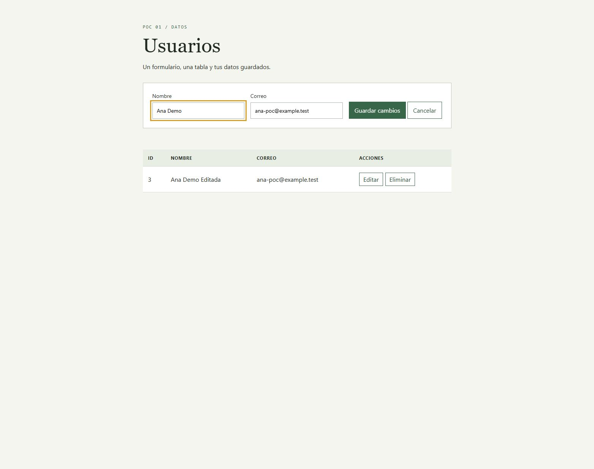
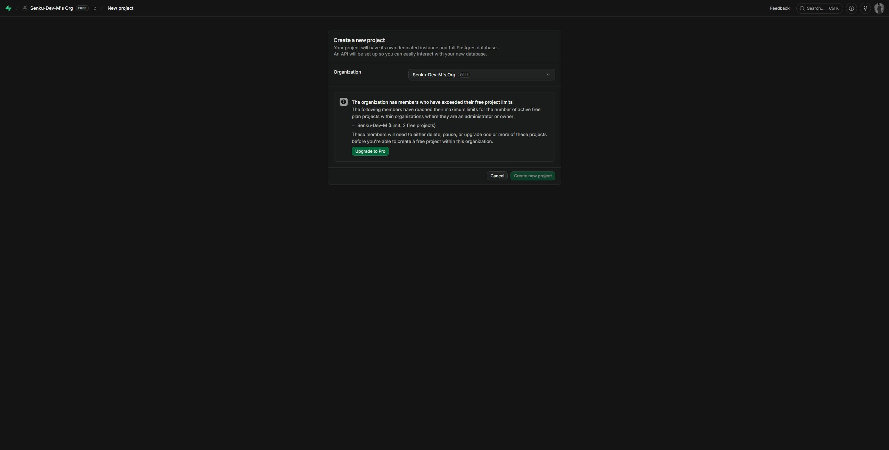
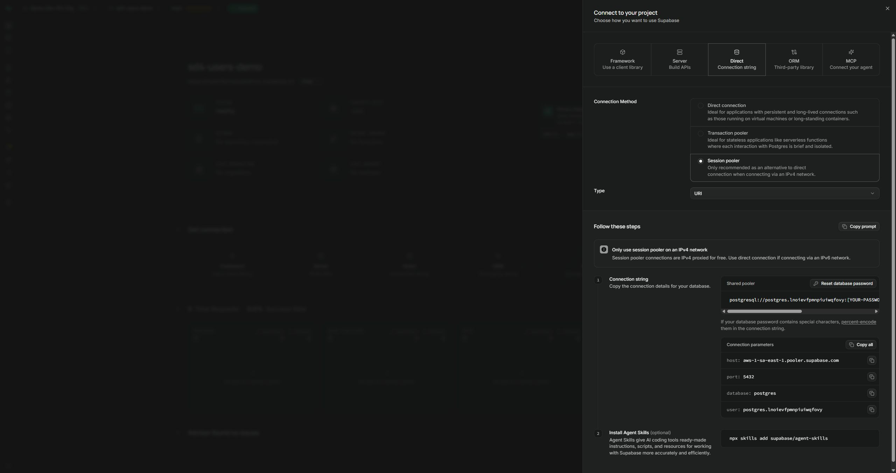
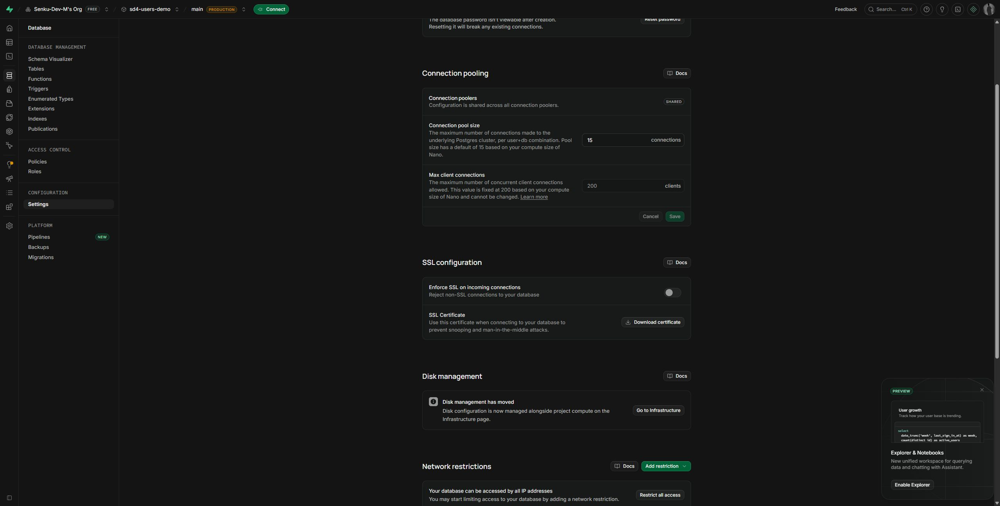
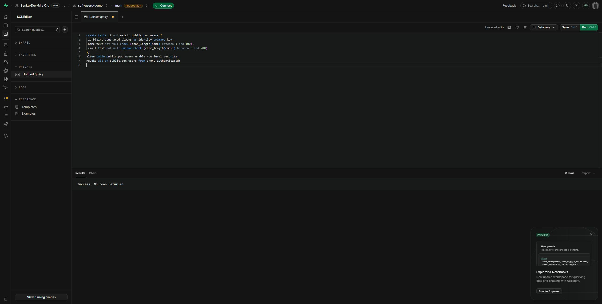

# POC 01: CRUD con C# y PostgreSQL en Supabase

El ejemplo tradicional: **host + puerto + base de datos + usuario + contraseña**,
SQL escrito a mano y el driver **Npgsql**. Supabase solo aloja PostgreSQL.
El backend se organiza en **Models, Services, Repositories y Controllers**,
con clases normales, constructores explícitos, `Program.Main` y `Startup`.
No usamos su SDK ni Entity Framework. Todo sigue dentro de un solo proyecto C#.



## Qué necesitas

- .NET SDK 10 (`dotnet --version`).
- Una cuenta de [Supabase](https://supabase.com/dashboard).
- Navegador y conexión a Internet. No necesitas Docker ni PostgreSQL local.

Los dos POCs pueden usar **un solo proyecto gratuito de Supabase**. Para la
validación se reutilizó `sd4-users-demo`; este POC tiene su tabla `poc_users`,
separada del ejemplo anterior. No se creó otro proyecto de pago.

## 1. Crear un proyecto en Supabase

Si ya tienes un proyecto, úsalo y salta al paso 2.

1. Abre el Dashboard e inicia sesión.
2. Elige una organización que indique **Free**.
3. Presiona **New project**.
4. Escribe un nombre, por ejemplo `poc-supabase`.
5. Crea una contraseña fuerte para la base de datos y guárdala en tu gestor de
   contraseñas. No es la contraseña de tu cuenta Supabase.
6. Elige una región cercana; para esta práctica se usó São Paulo (`sa-east-1`).
7. Deja la integración con GitHub sin configurar.
8. Para este CRUD no necesitamos la Data API. Si la dejas activa para otras
   prácticas, desactiva `Automatically expose new tables` y activa RLS.
9. Presiona **Create new project** y espera a que el estado sea **Healthy**.



En esta cuenta el Dashboard ya muestra el límite de proyectos gratuitos y no
abre el formulario completo. Por eso reutilizamos el proyecto existente. Si te
aparece ese mensaje, no necesitas pagar ni borrar otro proyecto para hacer
estos POCs. Los pasos anteriores describen el flujo para una cuenta con cupo;
los nombres y ubicación de opciones pueden cambiar con el Dashboard.

## 2. Obtener host, puerto, usuario y contraseña

1. Entra a tu proyecto.
2. Presiona **Connect**, en la barra superior.
3. Selecciona **Direct / Connection string**.
4. En **Connection Method**, selecciona **Session pooler**.
5. Copia los valores mostrados en **Connection parameters**.



| Variable del `.env` | Dónde obtenerla | Ejemplo de formato |
| --- | --- | --- |
| `PGHOST` | `host` del diálogo Connect | `aws-1-sa-east-1.pooler.supabase.com` |
| `PGPORT` | `port` | `5432` |
| `PGDATABASE` | `database` | `postgres` |
| `PGUSER` | `user` | `postgres.TU_PROJECT_REF` |
| `PGPASSWORD` | Contraseña que guardaste al crear el proyecto | Tu contraseña de base de datos |
| `PGSSLROOTCERT` | Archivo descargado en el paso 3 | `certs/prod-ca-2021.crt` |

**Copia el host real de tu Dashboard.** No lo construyas a partir de la región:
puede tener otro índice (`aws-0`, `aws-1`, etc.).

Usamos Session pooler porque permite conectarse por IPv4 gratuitamente. La
conexión directa `db.TU_PROJECT_REF.supabase.co` usa IPv6 por defecto. No necesitas
comprar el add-on IPv4 para hacer esta práctica.

No confundas:

- `https://TU_PROJECT_REF.supabase.co`: URL HTTP de las APIs, **no** es `PGHOST`.
- `postgres.TU_PROJECT_REF`: usuario del pooler, **no** tu email de Supabase.
- `PGPASSWORD`: contraseña PostgreSQL, **no** una secret key `sb_secret_...`.

El Dashboard no permite volver a ver la contraseña PostgreSQL. Si la perdiste,
puedes restablecerla en `Database > Settings > Database password`, pero tendrás
que actualizar las aplicaciones que ya usen la contraseña anterior.

## 3. Descargar el certificado público

1. Abre **Database > Settings**.
2. Busca **SSL configuration**.
3. Presiona **Download certificate**.
4. Guarda el archivo en `certs/prod-ca-2021.crt`, dentro de este POC.



Se incluye el certificado **público** que ofrece Supabase para esta práctica;
no es una contraseña ni una clave privada. Para reproducir el ejercicio,
comprueba que corresponde al certificado que ofrece tu Dashboard.

Si el navegador bloquea la descarga, el enlace público observado en el
Dashboard durante esta práctica permite descargarlo desde PowerShell:

```powershell
New-Item -ItemType Directory -Path certs -Force
Invoke-WebRequest "https://supabase-downloads.s3-ap-southeast-1.amazonaws.com/prod/ssl/prod-ca-2021.crt" -OutFile certs/prod-ca-2021.crt
```

`SslMode.VerifyFull` cifra la conexión y comprueba el certificado y el nombre
del servidor. No es necesario instalar el certificado en Windows ni desactivar
la validación TLS.

## 4. Crear la tabla

1. Abre **SQL Editor** en el Dashboard.
2. Abre una consulta nueva.
3. Copia el contenido completo de [schema.sql](schema.sql).
4. Presiona **Run**. Debe indicar `Success. No rows returned`.
5. En **Table Editor**, selecciona el esquema `public` y la tabla `poc_users`.



La tabla solo tiene `id`, `name` y `email`. PostgreSQL genera el ID y garantiza
que el correo sea único. RLS queda habilitado y `anon`/`authenticated` no reciben
acceso: el navegador habla con nuestro backend, no con la Data API.

Para que el POC sea corto conectamos con el usuario administrativo `postgres`,
que omite RLS. Es suficiente para esta práctica local; una aplicación real debe
usar un rol propio con permisos limitados. Estos registros no son cuentas de
Supabase Auth ni permiten iniciar sesión.

Security Advisor puede mostrar `RLS Enabled No Policy` como **Info** para
`poc_users`. Aquí es intencional: no damos acceso a la Data API y el backend
conecta por PostgreSQL. No hace falta agregar una política pública para quitar
el aviso. La revisión de esta práctica terminó con cero errores y cero warnings.

## 5. Configurar y ejecutar C#

Abre una terminal **en esta carpeta**:

```powershell
Copy-Item .env.example .env
```

Si ya está configurado el `.env` local, no lo sobrescribas. En una copia nueva,
edítalo con los datos de tu proyecto:

```env
PGHOST=TU_HOST_REAL.pooler.supabase.com
PGPORT=5432
PGDATABASE=postgres
PGUSER=postgres.TU_PROJECT_REF
PGPASSWORD="TU_PASSWORD_DE_BASE_DE_DATOS"
PGSSLROOTCERT=certs/prod-ca-2021.crt
```

Ejecuta:

```powershell
dotnet restore
dotnet run --urls http://127.0.0.1:4182
```

Abre [http://127.0.0.1:4182](http://127.0.0.1:4182). Crea un usuario, pulsa
**Editar**, cambia su nombre y guarda. Luego pulsa **Eliminar**. Puedes recargar
la página para comprobar que los datos están en PostgreSQL.

Para comprobar solo la conexión:

```powershell
Invoke-RestMethod http://127.0.0.1:4182/api/health
```

El resultado debe incluir `status: ok` y `driver: Npgsql`.

## 6. Organización del backend

```text
Program.cs                         Clase Program y método Main explícito
Startup.cs                         Configuración, conexión, dependencias y rutas
Models/User.cs                     Usuario almacenado
Models/UserRequest.cs              Datos de entrada y validaciones de formulario
Controllers/UsersController.cs     Endpoints HTTP del CRUD
Controllers/HealthController.cs    Comprobación de conexión
Services/UsersService.cs           Validación, normalización y operaciones
Repositories/UsersRepository.cs    SQL y acceso con Npgsql
schema.sql                         La tabla que debes crear en Supabase
.env.example                       Variables sin credenciales reales
certs/                             Certificado público para verificar TLS
wwwroot/                           Formulario HTML, JavaScript y CSS
```

| Carpeta | Responsabilidad | Qué no hace |
| --- | --- | --- |
| Models | Define `User` y `UserRequest` | No ejecuta SQL |
| Controllers | Recibe HTTP y devuelve 200, 201, 404 o 204 | No consulta la base de datos |
| Services | Valida y normaliza nombre/correo; coordina la operación | No contiene SQL |
| Repositories | Ejecuta SQL parametrizado y convierte filas en `User` | No devuelve respuestas HTTP |

El recorrido de una creación es:

```text
HTML/JS → UsersController.Create(UserRequest)
        → UsersService.CreateAsync()
        → UsersRepository.CreateAsync()
        → PostgreSQL de Supabase
```

Los modelos viajan entre esas clases. El mapeo de una fila a `User` es un método
pequeño dentro del repositorio; no necesitamos una librería de mapeo ni
interfaces adicionales para este POC.

`Program.Main` carga `.env` y arranca el host con `UseStartup<Startup>()`.
`Startup.ConfigureServices` construye la conexión con `NpgsqlConnectionStringBuilder`
y registra las dependencias. `NpgsqlDataSource` se registra como singleton para
reutilizar un pool de hasta cinco conexiones; servicio y repositorio son scoped.
`Startup.Configure` habilita archivos estáticos, manejo de errores y rutas de
controladores con `MapControllers()`.

El arranque tiene la forma tradicional:

```csharp
namespace PocPostgresCrud
{
    public class Program
    {
        public static void Main(string[] args)
        {
            // La implementación completa carga .env antes de construir el host.
            IHost host = CreateHostBuilder(args).Build();
            host.Run();
        }

        // CreateHostBuilder y ConfigureWebHost están completos en Program.cs.
    }
}
```

Se usa .NET 10, pero sin instrucciones de nivel superior, records, constructores
primarios ni `using` implícitos. Los namespaces tienen llaves y cada archivo
declara sus imports. No se cambió a un runtime antiguo para usar esta forma.

El SQL es explícito:

```csharp
string sql = "insert into public.poc_users (name, email) values (@name, @email) returning id";
using (NpgsqlCommand command = _dataSource.CreateCommand(sql))
{
    command.Parameters.AddWithValue("name", user.Name);
    command.Parameters.AddWithValue("email", user.Email);
    object? result = await command.ExecuteScalarAsync();
    user.Id = Convert.ToInt64(result);
}
```

`@name` y `@email` son parámetros: los datos no se concatenan al SQL. Los bloques
`using (...) { ... }` liberan los recursos. Para usar otra instalación PostgreSQL, cambia los valores
de conexión y su certificado; el CRUD sigue siendo SQL PostgreSQL.

| Método | Ruta | Uso |
| --- | --- | --- |
| GET | `/api/users` | Listar |
| GET | `/api/users/{id}` | Consultar uno |
| POST | `/api/users` | Crear |
| PUT | `/api/users/{id}` | Editar |
| DELETE | `/api/users/{id}` | Eliminar |

POST y PUT reciben JSON: `{"name":"Ana","email":"ana@example.test"}`.

`[ApiController]` y las anotaciones de `UserRequest` comprueban campos requeridos,
longitud y formato de correo. El servicio aplica las reglas antes de guardar.
El índice único de PostgreSQL protege también frente a correos duplicados y
`Startup` convierte ese error en HTTP 409.

Si quisieras reconstruir este proyecto desde cero:

```powershell
dotnet new webapi --use-controllers --use-program-main --no-openapi --exclude-launch-settings -n PocPostgresCrud
cd PocPostgresCrud
dotnet add package Npgsql --version 10.0.3
dotnet add package DotNetEnv --version 3.2.0
```

Después reemplaza el `Program.cs` generado por el de esta carpeta, agrega
`Startup.cs` y las cuatro carpetas del backend, y elimina el controlador/modelo
`WeatherForecast` si la plantilla lo creó. Copia también `wwwroot`, `schema.sql`,
`.env.example` y `certs`. En el `.csproj` de este ejemplo `ImplicitUsings` está
desactivado para que los imports estén escritos explícitamente.

`DotNetEnv` solo carga
el archivo `.env`; no tiene relación con Supabase. Las variables del sistema
tienen prioridad sobre el archivo.

## Errores frecuentes y costos

| Síntoma | Revisa |
| --- | --- |
| No se resuelve el host / conexión agotada | Host copiado de Connect, Session pooler y proyecto activo |
| Password authentication failed | Contraseña PostgreSQL y usuario completo del pooler |
| SSL handshake / certificate | Ruta `PGSSLROOTCERT` y certificado del Dashboard |
| Relation `poc_users` does not exist | Ejecutaste `schema.sql` en el mismo proyecto |
| HTTP 409 | El correo ya existe |

Mantén la organización en **Free**, reutiliza el mismo proyecto para ambos
POCs y revisa **Organization > Usage**. No actives add-ons ni cambies el plan
para resolver una conexión IPv4. Free tiene cuotas y puede pausar proyectos
inactivos; no es un servicio ilimitado. Si pasas a Pro, revisa Spend Cap y los
cargos de compute/add-ons, que no se controlan todos con ese límite.

El backend y la UI quedan locales; la tabla está en Supabase Cloud. `.env` está
ignorado por Git. Este POC no tiene login: úsalo en `127.0.0.1`, no como API
administrativa pública.

## Referencias

- [Conexiones PostgreSQL y Session pooler](https://supabase.com/docs/guides/database/connecting-to-postgres)
- [Certificado SSL de Supabase](https://supabase.com/docs/guides/platform/ssl-enforcement)
- [Npgsql: uso básico y parámetros](https://www.npgsql.org/doc/basic-usage.html)
- [Npgsql: cifrado y certificados](https://www.npgsql.org/doc/security.html)
- [Aviso informativo de RLS sin políticas](https://supabase.com/docs/guides/database/database-linter?lint=0008_rls_enabled_no_policy)
- [Facturación](https://supabase.com/docs/guides/platform/billing-on-supabase)
- [Control de costos](https://supabase.com/docs/guides/platform/cost-control)

## Guía de métodos: leer el CRUD paso a paso

| Clase / método | Qué hace y por qué |
| --- | --- |
| `Program.Main`, `CreateHostBuilder`, `ConfigureWebHost` | Cargan la configuración y arrancan el host tradicional con Startup. |
| `Startup.ConfigureServices` | Lee las variables, configura TLS verificado y registra un pool pequeño de conexiones y las dependencias. |
| `Startup.Configure` / `ConfigureEndpoints` | Sirven el frontend y habilitan controladores. |
| `Startup.Required` | Detecta variables faltantes al arrancar. |
| `ConfigureErrorHandler` / `WriteErrorAsync` | Devuelven 400 por datos inválidos, 409 por correo duplicado y 500 genérico sin filtrar secretos. |
| `UsersController.GetAll / GetById` | Devuelven lista o usuario; 404 si no existe. No ejecutan SQL. |
| `UsersController.Create / Update / Delete` | Reciben JSON o ID y convierten el resultado del servicio en 201, 200, 204 o 404. |
| `UsersService.GetAllAsync / GetByIdAsync / DeleteAsync` | Delegan al repositorio; dejan las decisiones HTTP al controlador. |
| `UsersService.CreateAsync / UpdateAsync` | Llaman a BuildUser antes de persistir. |
| `UsersService.BuildUser` | Recorta espacios, normaliza email y valida reglas; no confía solo en el formulario. |
| `UsersRepository.GetAllAsync / GetByIdAsync` | Ejecutan SELECT y convierten filas con ReadUser. |
| `UsersRepository.CreateAsync` | Inserta con parámetros y obtiene el ID con RETURNING. |
| `UsersRepository.UpdateAsync / DeleteAsync` | Usan ID parametrizado y comprueban filas afectadas para detectar un usuario inexistente. |
| `UsersRepository.ReadUser` | Mapea las columnas en orden al modelo User, sin librerías adicionales. |
| `HealthController.Get` / `CheckConnectionAsync` | Llegan a SELECT 1 para comprobar la DB sin modificar usuarios. |

Para seguir una operación, empieza por el botón del frontend en `wwwroot/app.js`,
busca su ruta en el controlador y sigue servicio → repositorio → SQL.
No concatenamos datos al SQL: los parámetros evitan tratar entradas como instrucciones.
El ID lo genera PostgreSQL, no el formulario.

## Prueba manual de aprendizaje

1. Configura tu propio proyecto y `.env` siguiendo los pasos anteriores.
2. Comprueba `/api/health` y crea a Ana con `ana@example.test`.
3. Recarga la pantalla para comprobar persistencia en la nube.
4. Edita el nombre y comprueba el cambio.
5. Intenta crear otro usuario con el mismo correo: debe mostrar un error.
6. Borra el usuario creado para la práctica y recarga.

No se incluyen tests ni scripts auxiliares: esta secuencia usa el frontend y el backend reales.
