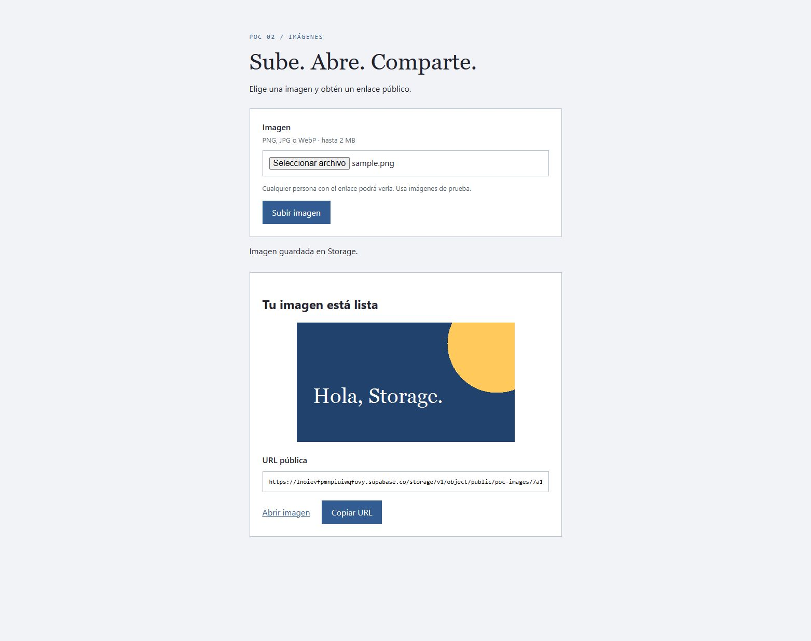
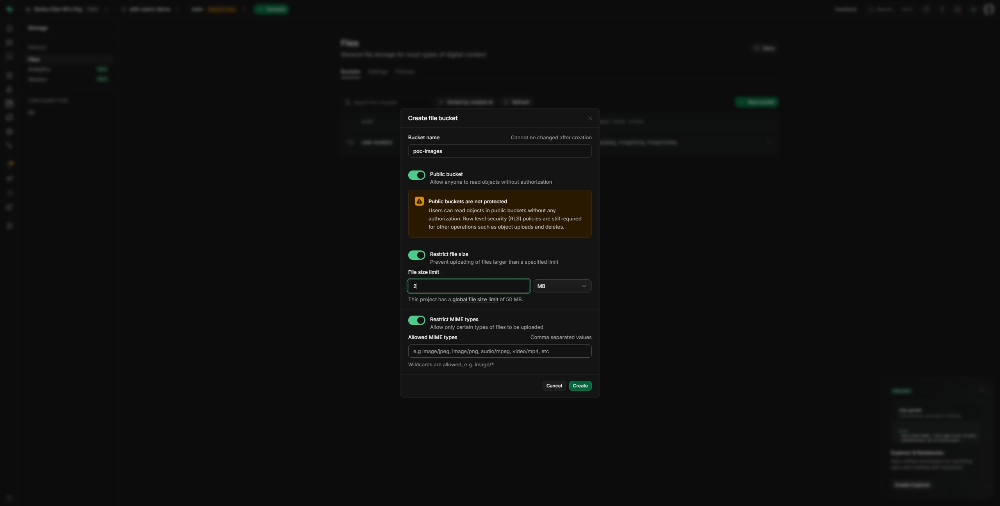
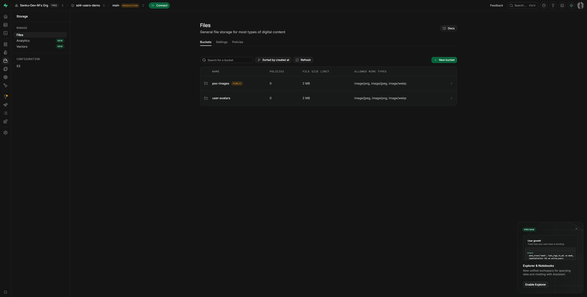
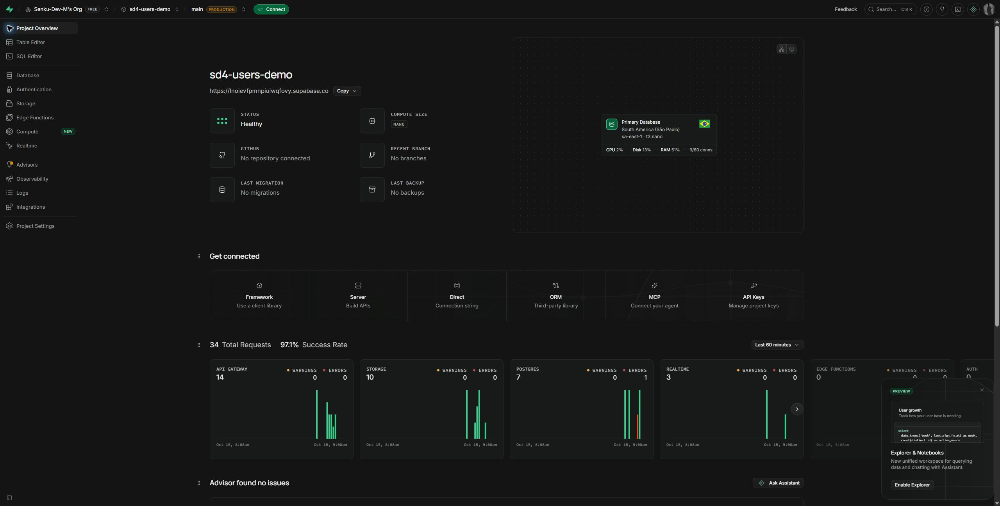
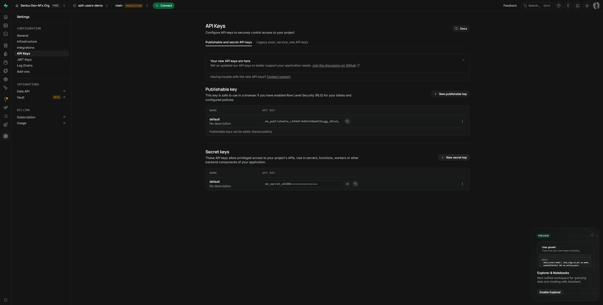

# POC 02: subir una imagen y obtener su URL pública

Un formulario HTML envía una imagen a C#. C# la sube a Supabase Storage con
**HttpClient** y devuelve una URL pública. No usamos el SDK de Supabase,
PostgreSQL ni una arquitectura grande. El backend usa cuatro carpetas:
**Models, Services, Repositories y Controllers**, con `Program.Main`, `Startup`
y clases/constructores explícitos. Todo está en un solo proyecto C#.



## Qué necesitas

- .NET SDK 10 (`dotnet --version`).
- Una cuenta de [Supabase](https://supabase.com/dashboard).
- Una imagen PNG, JPG o WebP de hasta 2 MB para probar.

Puedes usar el mismo proyecto gratuito que el POC de CRUD. Para validar se
reutilizó `sd4-users-demo` y se creó el bucket nuevo **`poc-images`**. El bucket
privado `user-avatars` del ejemplo anterior conserva su configuración.

## 1. Crear el proyecto de Supabase

Si ya tienes un proyecto, salta al paso 2.

1. Abre el Dashboard e inicia sesión.
2. Elige una organización **Free** y presiona **New project**.
3. Escribe un nombre, por ejemplo `poc-supabase`.
4. Crea una contraseña fuerte de base de datos y guárdala. Este POC de Storage
   no necesita esa contraseña para funcionar.
5. Elige una región cercana; aquí se usó São Paulo (`sa-east-1`).
6. Deja GitHub sin conectar y no actives add-ons de pago.
7. Presiona **Create new project** y espera el estado **Healthy**.


Esta cuenta ya alcanzó el límite de proyectos gratuitos; el Dashboard no abre
el formulario completo. Reutilizamos el proyecto existente para ambos POCs.
Si aparece este mensaje, no necesitas pagar ni borrar otro proyecto para hacer
la práctica. Los pasos anteriores sirven cuando la cuenta tiene cupo disponible.

## 2. Crear un bucket público

1. Abre **Storage** en el menú izquierdo.
2. En **Files > Buckets**, presiona **New bucket**.
3. Escribe **`poc-images`** como nombre.
4. Activa **Public bucket**.
5. Activa **Restrict file size** e indica **2 MB**.
6. Activa **Restrict MIME types** y escribe:
   `image/png,image/jpeg,image/webp`.
7. Presiona **Create**.



La lista debe mostrar `poc-images`, la etiqueta **PUBLIC**, 2 MB y los tres
tipos permitidos:



**Público significa que cualquiera que tenga la URL puede leer la imagen.**
No subas documentos personales ni imágenes privadas. La URL no caduca por
tiempo, aunque dejará de servir si se elimina el archivo/bucket/proyecto o
el proyecto deja de estar disponible; una caché puede conservar copias durante
un tiempo.

Ser público permite leer, no subir o borrar libremente. No agregamos políticas
de escritura para `anon`: las subidas las realiza el backend con su secret key.
No necesitas crear una tabla SQL ni configurar Supabase Auth para este POC.

## 3. Obtener la URL y la secret key

### URL del proyecto

En **Project Overview**, copia la dirección debajo del nombre del proyecto:

```text
https://TU_PROJECT_REF.supabase.co
```

También aparece en **Connect**. No uses la dirección `supabase.com/dashboard/...`
de tu navegador ni el host PostgreSQL `db....supabase.co`.



### Clave del backend

1. Abre **Project Settings**.
2. Selecciona **API Keys**.
3. Abre **Publishable and secret API keys** si hay más de una pestaña.
4. En **Secret keys**, copia la clave `default` con el botón de copiar.
5. Debe comenzar con **`sb_secret_`**.



No confundas la secret key con la publishable key ni con la contraseña de
PostgreSQL. La secret key es privilegiada y omite RLS: solo debe existir en el
backend. No la pegues en `app.js`, en el README, en capturas ni en Git.

## 4. Configurar y ejecutar el backend

Abre una terminal **en esta carpeta**. En una copia nueva:

```powershell
Copy-Item .env.example .env
```

Si tu `.env` ya está configurado, no lo sobrescribas. Completa:

```env
SUPABASE_URL=https://TU_PROJECT_REF.supabase.co
SUPABASE_SECRET_KEY=sb_secret_TU_CLAVE_REAL
SUPABASE_BUCKET=poc-images
```

| Variable | De dónde sale | Para qué sirve |
| --- | --- | --- |
| `SUPABASE_URL` | Project Overview / Connect | Dirección del proyecto y de Storage |
| `SUPABASE_SECRET_KEY` | Project Settings > API Keys > Secret keys | Autorizar la subida desde C# |
| `SUPABASE_BUCKET` | Nombre que elegiste al crear el bucket | Destino de las imágenes |

Ejecuta:

```powershell
dotnet restore
dotnet run --urls http://127.0.0.1:4183
```

Abre [http://127.0.0.1:4183](http://127.0.0.1:4183), elige una imagen y presiona
**Subir imagen**. Verás la vista previa, la URL, **Abrir imagen** y **Copiar URL**.
Abre el enlace en una ventana privada: debe funcionar sin iniciar sesión.

Puedes usar [docs/sample.png](docs/sample.png), la ilustración incluida para
probar sin subir fotografías personales. Se dejó una copia ilustrativa en el
bucket al validar; las demás imágenes temporales se eliminaron.

Puedes verificar también el archivo en **Storage > poc-images**.

## 5. Cómo funciona: tres pasos

```text
Formulario HTML → POST /api/images en C# → Supabase Storage
Formulario HTML ← { "url": "https://.../object/public/..." }
```

El navegador manda `multipart/form-data`, con el archivo en el campo `image`.
`ImagesController` recibe `ImageUploadRequest` y llama a `ImagesService`.
El servicio comprueba el tamaño y el MIME, genera un nombre UUID y llama a
`StorageRepository`. El repositorio envía los bytes con
`Content-Type: image/png`, `image/jpeg` o `image/webp`.

La llamada HTTP a Storage es:

```http
POST https://TU_PROJECT_REF.supabase.co/storage/v1/object/poc-images/NOMBRE.png
apikey: TU_SECRET_KEY
Content-Type: image/png

[bytes de la imagen]
```

En `Repositories/StorageRepository.cs`:

```csharp
using (HttpClient client = _clientFactory.CreateClient("storage"))
using (StreamContent content = new StreamContent(stream))
{
    content.Headers.ContentType = new MediaTypeHeaderValue(contentType);
    string path = "object/" + _bucket + "/" + filename;
    using (HttpResponseMessage response = await client.PostAsync(path, content))
    {
        response.EnsureSuccessStatusCode();
    }
}
```

Después de comprobar que la subida fue exitosa se construye la URL:

```text
https://TU_PROJECT_REF.supabase.co/storage/v1/object/public/poc-images/NOMBRE.png
```

La URL pública no necesita clave ni token. Construirla no realiza otra subida
ni demuestra por sí solo que el archivo existe: por eso primero comprobamos la
respuesta HTTP y en las pruebas abrimos el enlace real.

HttpClient evita depender del SDK, pero esta ruta HTTP sigue siendo la API de
Supabase Storage. Para otro proveedor habría que cambiar esa llamada. No es la
misma conexión PostgreSQL del POC 01. Para una alternativa de protocolo más
portable, Supabase también ofrece compatibilidad S3; queda fuera de este ejemplo.

## Organización del backend

```text
Program.cs                         Clase Program y método Main explícito
Startup.cs                         Configuración, HttpClient y controladores
Models/ImageUploadRequest.cs       Archivo recibido del formulario
Models/UploadedImage.cs            Respuesta con la URL pública
Controllers/ImagesController.cs    POST /api/images
Services/ImagesService.cs          Valida imagen y genera nombre de archivo
Repositories/StorageRepository.cs  Llamada HTTP a Storage y URL resultante
.env.example                       Tres variables de ejemplo
wwwroot/                           HTML, JavaScript y CSS
docs/                              Capturas e imagen ilustrativa sample.png
```

| Carpeta | Responsabilidad |
| --- | --- |
| Models | Define qué entra (`ImageUploadRequest`) y qué sale (`UploadedImage`) |
| Controllers | Recibe el formulario y devuelve el resultado HTTP |
| Services | Valida archivo, tamaño y MIME; genera el UUID |
| Repositories | Sube los bytes usando HttpClient y construye la URL pública |

```text
HTML/JS → ImagesController.Upload(ImageUploadRequest)
        → ImagesService.UploadAsync()
        → StorageRepository.UploadAsync()
        → Supabase Storage
```

`Program.Main` carga `.env`, construye el host y arranca `Startup`.
`Startup.ConfigureServices` registra `HttpClient` con la URL y la clave, además
del servicio, repositorio y controladores. `Startup.Configure` sirve la pantalla,
configura el manejo de errores y habilita las rutas de los controladores.

El controlador tiene un constructor explícito que recibe `ImagesService`.
El servicio recibe `StorageRepository` de la misma forma. ASP.NET Core crea
estas instancias usando los registros de `Startup`.

Se usa .NET 10 con sintaxis de clases tradicional: `Program.Main`, namespaces
con llaves, constructores normales y bloques `using (...) { ... }`. No hay
instrucciones de nivel superior, records, constructores primarios ni imports
implícitos. No se necesita un mapper para estos dos modelos pequeños.

Para reconstruirlo desde cero:

```powershell
dotnet new webapi --use-controllers --use-program-main --no-openapi --exclude-launch-settings -n PocStorageUpload
cd PocStorageUpload
dotnet add package DotNetEnv --version 3.2.0
```

Después reemplaza `Program.cs`, agrega `Startup.cs` y las cuatro carpetas del
backend. Elimina el controlador/modelo `WeatherForecast` si la plantilla lo
creó. Copia `wwwroot` y `.env.example`; en el `.csproj` de este ejemplo
`ImplicitUsings` está desactivado para escribir los imports explícitamente.

`HttpClient` ya viene con .NET;
`DotNetEnv` solo carga el archivo `.env`. Las variables del sistema tienen
prioridad. No hace falta instalar el paquete `Supabase`.

## Errores, limpieza y costos

| Síntoma | Revisa |
| --- | --- |
| No se pudo subir la imagen | Secret key correcta, URL, proyecto y nombre exacto del bucket |
| La subida funciona pero la URL no abre | El bucket debe tener la etiqueta PUBLIC |
| El máximo es 2 MB | Reduce el archivo; el límite existe en C# y en el bucket |
| Usa PNG, JPG o WebP | Selecciona uno de esos tipos |
| No se pudo contactar con Storage | URL HTTPS correcta, proyecto activo y red |

Cada subida genera un archivo nuevo. Para limpiar prácticas: entra a
**Storage > poc-images**, selecciona las imágenes de prueba, elige **Delete**
y confirma. Esta eliminación no tiene papelera; verifica qué archivo elegiste.
El POC no incluye listado ni borrado para que el endpoint de subida sea fácil
de leer.

Mantén **Free**, reutiliza el proyecto existente y revisa **Organization >
Usage**: guardar archivos consume Storage y abrirlos consume egress. Un bucket
público no significa almacenamiento ni descargas ilimitadas. Usa imágenes
pequeñas, evita recargas automáticas y limpia archivos de prueba. No actives
add-ons ni cambies a Pro para completar este ejercicio. En un plan de pago,
revisa Spend Cap y los cargos que quedan fuera de ese límite.

El backend y la pantalla quedan locales; las imágenes están en Supabase Cloud.
`.env` está ignorado por Git. El backend no tiene login: ejecútalo en
`127.0.0.1`. Antes de publicarlo necesitarías controlar quién puede subir,
limitar solicitudes y verificar el contenido real del archivo, además del MIME.

## Referencias

- [Crear buckets](https://supabase.com/docs/guides/storage/buckets/creating-buckets)
- [Subidas estándar](https://supabase.com/docs/guides/storage/uploads/standard-uploads)
- [URLs públicas y privadas](https://supabase.com/docs/guides/storage/serving/downloads)
- [API keys](https://supabase.com/docs/guides/getting-started/api-keys)
- [Storage S3](https://supabase.com/docs/guides/storage/s3/authentication)
- [Facturación](https://supabase.com/docs/guides/platform/billing-on-supabase)
- [Control de costos](https://supabase.com/docs/guides/platform/cost-control)

## Guía de métodos: seguir una imagen

| Clase / método | Qué hace y por qué |
| --- | --- |
| `Program.Main / CreateHostBuilder / ConfigureWebHost` | Cargan .env y arrancan el host tradicional con Startup. |
| `Startup.ConfigureServices` | Lee URL, clave y bucket; registra HttpClient con apikey solo en el servidor. |
| `Startup.Required` | Impide arrancar con una variable obligatoria vacía. |
| `Startup.Configure / ConfigureEndpoints` | Sirven el formulario y publican POST /api/images. |
| `ConfigureErrorHandler / WriteErrorAsync` | Convierten validaciones en 400 y fallos de la subida en 502 sin exponer credenciales. |
| `ImagesController.Upload` | Recibe multipart/form-data y devuelve JSON con url. |
| `ImagesService.UploadAsync` | Valida tamaño y MIME, genera un nombre UUID y entrega el stream al repositorio sin guardar localmente. |
| `StorageRepository.UploadAsync` | Hace POST de los bytes a Storage; verifica la respuesta antes de construir la URL pública. |

En `wwwroot/app.js`, el formulario construye un `FormData` con el campo `image`
y lo envía al backend. JavaScript no conoce la secret key. La URL resultante se
muestra en pantalla para abrirla o copiarla. Publicar el bucket permite leer
por URL, pero no concede automáticamente permisos para subir o borrar archivos.
[Modelo de acceso de buckets](https://supabase.com/docs/guides/storage/buckets/fundamentals).

El MIME proviene de la petición y puede falsificarse: el filtro sirve para esta
práctica, no sustituye verificar el contenido binario en una aplicación pública.

## Prueba manual de aprendizaje

1. Configura el bucket público y .env con tus valores.
2. Abre la UI y sube una imagen pequeña PNG, JPG o WebP.
3. Copia la URL resultante y ábrela en otra pestaña: debe mostrar la imagen sin clave.
4. Prueba sin archivo y con un tipo no permitido para ver las validaciones.
5. Revisa Storage en el Dashboard: el archivo debe estar en tu bucket.
6. Al finalizar, identifica y elimina únicamente tus imágenes de práctica desde el Dashboard.

No se incluyen tests ni scripts auxiliares. El POC no borra imágenes automáticamente.
