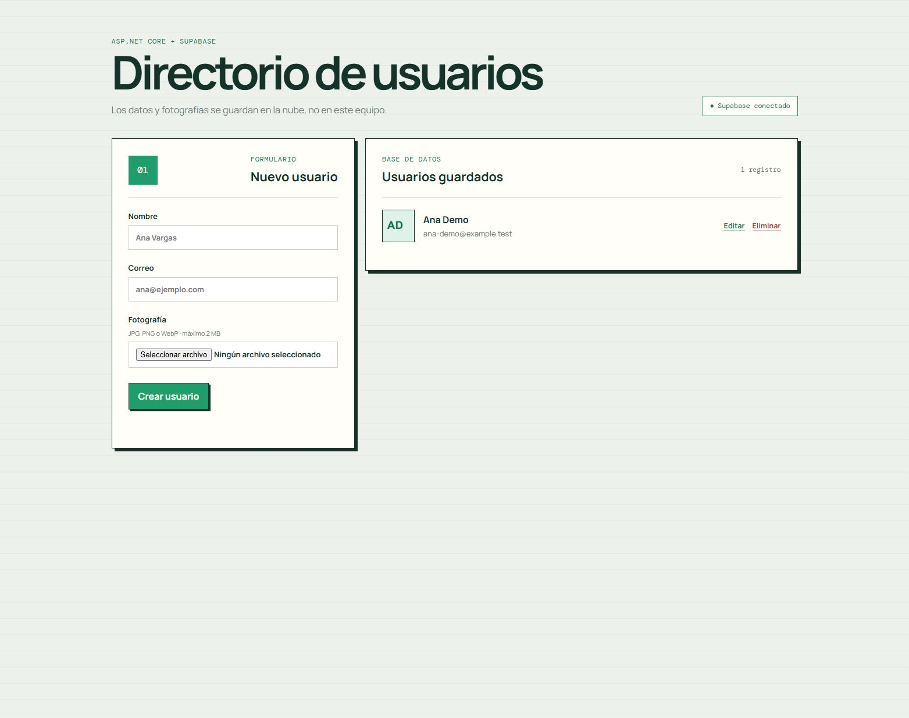

# CRUD de usuarios con ASP.NET Core y Supabase Cloud

Ejemplo educativo mínimo para conectar un backend C# con **Supabase Database**
y **Supabase Storage**. El frontend es HTML, CSS y JavaScript sin framework y
solo consume la API del backend.

Parte del monorepo de ejemplos. La configuración real queda en `.env` local y no se publica.



La captura usa un usuario ficticio de prueba que se eliminó al terminar.

## Qué demuestra

- CRUD de usuarios almacenados en PostgreSQL de Supabase;
- fotografía opcional guardada en un bucket privado de Storage;
- URLs firmadas durante una hora para visualizar las fotografías;
- configuración mediante `.env` sin exponer secretos al navegador;
- eliminación de la fotografía al reemplazarla o borrar el usuario;
- frontend pequeño para probar el flujo completo.

## Arquitectura

```text
Navegador (HTML/JS)
        │  /api/users + multipart/form-data
        ▼
ASP.NET Core 10
        │  SUPABASE_URL + SUPABASE_SECRET_KEY
        ├──────────► Supabase Database: public.user_profiles
        └──────────► Supabase Storage: user-avatars
```

El navegador **no se conecta directamente a Supabase** y nunca recibe la
`secret key`. Para este ejemplo el backend funciona como una aplicación
administrativa confiable y es el único autorizado a leer o modificar datos.

## 1. Plan gratuito y control de costos

Supabase organiza la facturación por organización. En octubre de 2026, el plan
Free incluye hasta **dos proyectos activos**, **500 MB de base de datos por
proyecto**, **1 GB de Storage**, **5 GB de egress sin caché** y **5 GB con
caché**. Las cuotas de Storage/egress se comparten en la organización; no se
multiplican por cada proyecto. Los límites y condiciones
pueden cambiar; verifica siempre la documentación oficial:

- [Facturación y cuotas](https://supabase.com/docs/guides/platform/billing-on-supabase)
- [Preguntas frecuentes de facturación](https://supabase.com/docs/guides/platform/billing-faq)
- [Pausa de proyectos gratuitos](https://supabase.com/docs/guides/platform/free-project-pausing)

Para evitar costos inesperados en este ejemplo:

1. crea el proyecto dentro de una organización **Free**;
2. no actives add-ons, compute adicional, IPv4 dedicado ni un plan de pago;
3. conserva el bucket privado y el límite de **2 MB por fotografía**;
4. revisa `Organization > Usage` para Database, Storage y Egress;
5. elimina imágenes reemplazadas o usuarios que ya no necesites;
6. recuerda que un proyecto Free con poca actividad puede pausarse después de
   siete días; restaurarlo no convierte el proyecto en uno pagado.

En Free no se cobra automáticamente un exceso como si fuera un proyecto Pro sin
Spend Cap: Supabase avisa y puede restringir el servicio. No uses esto como
sustituto del monitoreo de cuotas.

## 2. Crear el proyecto de Supabase

Desde [Supabase Dashboard](https://supabase.com/dashboard):

1. entra a una organización cuyo plan indique `Free`;
2. selecciona **New project**;
3. usa un nombre descriptivo, por ejemplo `sd4-users-demo`;
4. selecciona **South America (São Paulo) — `sa-east-1`**, cercana a Bolivia;
5. genera una contraseña fuerte de base de datos y guárdala en un administrador
   de contraseñas; este ejemplo no necesita ponerla en `.env`;
6. confirma que el plan/compute mostrado sea gratuito antes de crear el proyecto.
7. conserva `Enable Data API` activo; desmarca `Automatically expose new tables`
   y activa `Enable automatic RLS`. El SQL dará acceso explícito al backend.

Supabase Cloud no requiere instalar PostgreSQL, Storage, Docker ni la CLI de
Supabase en tu equipo. Solo necesitas una cuenta y el navegador para esta
práctica. La instalación local es únicamente la del SDK de .NET.

La región determina dónde se almacenan los datos principales y no puede
cambiarse simplemente después de crear el proyecto.

## 3. Crear tabla y bucket

Abre `SQL Editor > New query`, copia
[`supabase/schema.sql`](./supabase/schema.sql) y ejecútalo una vez.

El script crea:

- `public.user_profiles`, con correo único y RLS habilitado;
- permisos únicamente para el rol del backend;
- bucket privado `user-avatars`;
- límite de 2 MB y tipos JPG, PNG o WebP.

No se crean políticas para `anon` ni `authenticated` porque el frontend no debe
acceder directamente a Database o Storage. La secret key del servidor omite RLS
y por eso debe permanecer exclusivamente en el backend.

Puedes comprobar el resultado en:

- `Table Editor > user_profiles`;
- `Storage > user-avatars`.

Si quieres crear el bucket manualmente en otra práctica: entra a `Storage >
New bucket`, escribe `user-avatars`, deja `Public bucket` desactivado y configura
el tamaño máximo en 2 MB y los MIME `image/jpeg`, `image/png`, `image/webp`.
El SQL de este ejemplo ya realiza esa misma configuración, así que no necesitas
crear otro bucket.

El script también restringe `public.rls_auto_enable()` si el Dashboard la creó
para RLS automático: es un trigger administrativo, no un endpoint público.
El Advisor puede mostrar `RLS Enabled No Policy` como **INFO** para
`user_profiles`: aquí es intencional porque solo el backend con secret key
accede a la tabla. No agregues una política pública para silenciar ese aviso.

## 4. Obtener las variables

En el Dashboard abre el diálogo **Connect** o `Project Settings > API Keys`.
Necesitas:

| Variable | Procedencia | Uso |
| --- | --- | --- |
| `SUPABASE_URL` | Project URL | Dirección HTTPS del proyecto. |
| `SUPABASE_SECRET_KEY` | Secret key `sb_secret_...` | Acceso exclusivo del backend; omite RLS. |
| `SUPABASE_BUCKET` | Nombre elegido por nosotros | `user-avatars`. |

Supabase está reemplazando gradualmente las claves antiguas `anon` y
`service_role` por `publishable` y `secret`. Este ejemplo usa una **secret key**
actual. Si tu proyecto todavía solo muestra `service_role`, funciona de forma
equivalente para este backend, pero nunca debe ir al navegador.

Copia el archivo de ejemplo:

```powershell
Copy-Item .env.example .env
```

Completa el archivo local:

```env
SUPABASE_URL=https://TU_PROJECT_REF.supabase.co
SUPABASE_SECRET_KEY=sb_secret_REEMPLAZAR
SUPABASE_BUCKET=user-avatars
```

`.env` está ignorado por Git. No copies la secret key a `wwwroot`, JavaScript,
capturas, documentación ni mensajes.

## 5. Cómo se conecta C#

El proyecto usa el SDK oficial `Supabase` `8.3.1`. `Program.cs` carga `.env`,
crea una única instancia de `Supabase.Client` y la registra en inyección de
dependencias.

Las dependencias ya están declaradas en el `.csproj`. Si empiezas otro proyecto
desde cero, los comandos equivalentes son:

```powershell
dotnet new web -n SupabaseUsersDemo
cd SupabaseUsersDemo
dotnet add package Supabase --version 8.3.1
dotnet add package DotNetEnv --version 3.2.0
```

```csharp
var supabase = new Supabase.Client(
    supabaseUrl,
    supabaseSecretKey,
    new Supabase.SupabaseOptions
    {
        AutoConnectRealtime = false,
        AutoRefreshToken = false
    });

await supabase.InitializeAsync();
builder.Services.AddSingleton(supabase);
```

`UserProfileService` usa ese cliente para consultar `user_profiles` y el bucket.
La conexión viaja por HTTPS a la Data API de Supabase; no usa una conexión
PostgreSQL local ni requiere la contraseña de la base de datos. En el modelo,
`[Table]`, `[Column]` y `[PrimaryKey("id", true)]` indican cómo mapear C# a la
tabla. El `true` permite enviar el UUID generado por el backend al insertar.
La fotografía se sube primero; si falla la inserción de la fila, el servicio
elimina el archivo para no dejar basura. Al actualizar, crea una ruta nueva y
elimina la anterior después de guardar correctamente.

## 6. Ejecutar

Requiere .NET SDK 10.

```powershell
dotnet restore
dotnet run --urls http://127.0.0.1:4180
```

Abre [http://127.0.0.1:4180](http://127.0.0.1:4180). El indicador superior debe
mostrar **Supabase conectado**.

1. Crea un usuario con nombre y correo, con o sin fotografía.
2. Presiona `Editar`: puedes cambiar datos y elegir una nueva fotografía.
3. Si no eliges otra imagen, se conserva la anterior.
4. Presiona `Eliminar` y confirma: se borran la fila y la fotografía.
5. Recarga la página: los datos siguen en Supabase, no en `localStorage`.

Para probarlo usa la secuencia del frontend descrita arriba. No se requieren scripts adicionales.

## Estructura para leer el ejemplo

```text
Program.cs                    Endpoints, .env y registro del cliente Supabase
Models/UserProfile.cs         Mapeo de la tabla PostgreSQL
Contracts/UserResponse.cs     Datos devueltos al navegador
Services/UserProfileService.cs CRUD y operaciones de Storage
supabase/schema.sql           Configuración reproducible de tabla y bucket
wwwroot/                      Frontend HTML, CSS y JavaScript
.env.example                  Variables de ejemplo, sin claves reales
packages.lock.json            Versiones reproducibles de dependencias
```

## 7. Endpoints

| Método | Ruta | Descripción |
| --- | --- | --- |
| `GET` | `/api/health` | Comprueba el acceso a Supabase Cloud. |
| `GET` | `/api/users` | Lista usuarios y genera URLs firmadas. |
| `GET` | `/api/users/{id}` | Obtiene un usuario. |
| `POST` | `/api/users` | Crea usuario; recibe `multipart/form-data`. |
| `PUT` | `/api/users/{id}` | Actualiza datos y fotografía opcional. |
| `DELETE` | `/api/users/{id}` | Elimina fila y fotografía. |

Campos del formulario: `name`, `email` y `avatar` opcional.

## 8. Qué está en la nube y qué queda local

| Elemento | Ubicación |
| --- | --- |
| Filas de usuarios | PostgreSQL de Supabase Cloud |
| Fotografías | Supabase Storage Cloud |
| Backend C# durante la práctica | Equipo local |
| Frontend | Servido por ASP.NET Core desde `wwwroot` |
| Secret key | `.env` local del backend |

Para publicar el backend después, las mismas variables se configuran como
secretos del servicio de hosting. No se copia `.env` dentro de una imagen ni se
sube al repositorio.

## Límites intencionales

Este es un CRUD administrativo para aprendizaje, sin Supabase Auth. La secret
key hace que el backend tenga acceso total al proyecto. Antes de convertirlo en
una aplicación pública real habría que añadir autenticación, autorización por
usuario, rate limiting, observabilidad y políticas RLS basadas en propietarios.
Los usuarios de este ejemplo son filas de `user_profiles`; no son cuentas de
inicio de sesión en `Authentication > Users`. DB y Storage son servicios
distintos, por lo que la limpieza de imágenes es compensatoria y no una
transacción distribuida; si Storage falla al borrar, habría que reintentar la
limpieza en una aplicación real. El backend solo debe ejecutarse localmente
durante esta práctica.

## Referencias oficiales

- [SDK C# de Supabase](https://supabase.com/docs/reference/csharp/initializing)
- [Claves de API](https://supabase.com/docs/guides/getting-started/api-keys)
- [Control de acceso de Storage](https://supabase.com/docs/guides/storage/security/access-control)
- [URLs firmadas y buckets privados](https://supabase.com/docs/guides/storage/serving/downloads)
- [Regiones disponibles](https://supabase.com/docs/guides/platform/regions)
- [Egress con y sin caché](https://supabase.com/docs/guides/platform/manage-your-usage/egress)
- [Aviso INFO por RLS sin políticas](https://supabase.com/docs/guides/database/database-linter?lint=0008_rls_enabled_no_policy)

## Guía de métodos del SDK: qué hace cada uno

Este es el ejemplo combinado original: conserva Minimal API y el servicio del
SDK, a diferencia de los dos POCs tradicionales de Controllers/Services/Repositories.

| Método de UserProfileService | Qué hace y por qué |
| --- | --- |
| `GetAllAsync` | Consulta usuarios por fecha y genera la respuesta con sus fotos. |
| `GetByIdAsync` / `FindAsync` | Buscan por UUID y devuelven null si no existe para responder 404. |
| `CreateAsync` | Valida, sube la foto opcional e inserta la fila; si falla la DB intenta limpiar la foto nueva. |
| `UpdateAsync` | Guarda primero la nueva foto y la fila; luego retira la foto vieja, para no perderla antes de confirmar. |
| `DeleteAsync` | Borra la fila y después intenta limpiar su avatar. |
| `CanConnectAsync` | Consulta una fila como máximo para comprobar acceso real a la nube. |
| `EnsureEmailIsAvailableAsync` | Detecta correos ocupados, excluyendo al usuario editado; el índice UNIQUE es la garantía final. |
| `UploadAvatarAsync` | Valida y sube bytes mediante Storage.From(bucket).Upload a una ruta nueva. |
| `ToResponseAsync` | Convierte el modelo a UserResponse y crea una URL firmada válida durante una hora. |
| `TryRemoveAvatarAsync` | Intenta borrar una imagen; si falla, registra una advertencia sin ocultar la operación principal. |
| `NormalizeRequired / NormalizeEmail` | Recortan espacios y aplican reglas de longitud y formato básico. |
| `ValidateAvatar` | Rechaza archivo vacío, mayor de 2 MB o MIME no permitido; no inspecciona sus bytes. |

En `Program.cs`, los endpoints GET delegan consultas, POST/PUT leen el
formulario multipart y DELETE solicita el borrado. La configuración del SDK
queda en el backend. El frontend `wwwroot/app.js` solo llama a `/api/users`:
no recibe claves ni consulta directamente Supabase.

La limpieza entre DB y Storage es compensatoria, no atómica. Una URL firmada
da acceso temporal a quien la tenga; no la trates como un enlace público permanente.
El ejemplo no es un sistema de autenticación: los usuarios son filas de la tabla.

## Comparación con los POCs separados

- [CRUD PostgreSQL](../poc-postgres-crud): Npgsql y SQL por conexión PostgreSQL, sin SDK.
- [Storage HTTP](../poc-storage-upload): HttpClient y URL pública permanente mientras exista el objeto.
- Este ejemplo: SDK por HTTPS, datos + avatar privado y URL temporal.

En los tres casos el backend y la pantalla de prueba quedan locales; solo los
datos/archivos están en Supabase Cloud. Conserva tus variables reales en .env.
