# Supabase + .NET 10 + EF Core + PostgreSQL

Guía práctica, completa y reproducible para crear una base PostgreSQL en
Supabase, conectarla con una API mínima de .NET y construir la misma estructura
de dos maneras:

1. **Método 1 — EF Core:** una migración crea `public.products_ef`.
2. **Método 2 — SQL Editor:** un script SQL crea `public.products_sql` y EF Core
   solamente la consulta y modifica.

> Fecha de verificación de esta guía: **2 de noviembre de 2026**. Supabase puede
> mover controles del Dashboard. Si cambia la ubicación visual, conserva el
> concepto y busca el mismo nombre indicado aquí.

---

## Índice

1. [Resultado final](#1-resultado-final)
2. [Conceptos que no deben confundirse](#2-lo-que-no-debe-confundirse)
3. [Requisitos](#3-requisitos-previos)
4. [Crear el proyecto Supabase](#4-crear-el-proyecto-en-supabase)
5. [Obtener la conexión](#5-obtener-los-datos-de-conexión)
6. [Descargar y configurar el certificado](#6-descargar-y-utilizar-el-certificado-ssl)
7. [Crear los proyectos .NET](#7-crear-la-estructura-local)
8. [Guardar la conexión](#8-guardar-la-conexión-de-forma-segura)
9. [Método 1: EF Core](#método-1--ef-core-crea-products_ef)
10. [Método 2: SQL Editor](#método-2--sql-editor-crea-products_sql)
11. [Comparación](#19-comparar-las-estructuras)
12. [Errores frecuentes](#21-diagnóstico-de-errores-comunes)
13. [Checklist final](#22-checklist-final)

---

## 1. Resultado final

Al terminar tendrás dos APIs mínimas independientes y dos tablas con la misma
estructura:

| Aplicación | Tabla | Quién crea la tabla |
|---|---|---|
| `ProductsEf` | `public.products_ef` | Migración de Entity Framework Core |
| `ProductsSql` | `public.products_sql` | Script ejecutado en Supabase SQL Editor |

Las dos tablas tendrán estas columnas:

| Columna | PostgreSQL | Nulos | Función |
|---|---|---:|---|
| `id` | `integer generated by default as identity` | No | Clave primaria autogenerada |
| `name` | `varchar(120)` | No | Nombre del producto |
| `price` | `numeric(10,2)` | No | Precio con hasta dos decimales |

Cada API tendrá:

- `POST /products`: inserta un producto y devuelve HTTP `201 Created`.
- `GET /products`: devuelve todos los productos ordenados por `id`.
- Validación de nombre y precio antes de acceder a PostgreSQL.

La conexión utilizada por la aplicación será:

```text
.NET → EF Core → Npgsql → Session pooler de Supabase → PostgreSQL
```

La creación del esquema será diferente:

```text
Método 1: Modelo C# → migración EF Core → PostgreSQL
Método 2: SQL Editor → CREATE TABLE → PostgreSQL
```

---

## 2. Lo que NO debe confundirse

### 2.1 PostgreSQL

Es la base de datos real alojada por Supabase. Contiene tablas, columnas,
índices, restricciones y datos.

### 2.2 Direct connection

Conecta el cliente directamente con PostgreSQL. Es la opción recomendada por
Supabase para migraciones, `pg_dump`, copias de seguridad y restauraciones.

- Host típico: `db.<PROJECT_REF>.supabase.co`
- Puerto: `5432`
- Usuario: `postgres`
- En el plan gratuito normalmente requiere una red con IPv6.

### 2.3 Session pooler

Es un intermediario que mantiene una sesión PostgreSQL y permite conectar desde
redes IPv4. Es apropiado para un backend persistente cuando no se puede llegar a
la conexión directa.

- Host: debes copiarlo del Dashboard; no lo construyas a partir de la región.
- Puerto: `5432`.
- Usuario: `postgres.<PROJECT_REF>`.
- Admite características de sesión y prepared statements.

El pooler **no crea tablas**, **no sustituye PostgreSQL** y **no es el SDK de
Supabase**.

### 2.4 Transaction pooler

Está pensado para funciones serverless o edge con conexiones breves.

- Puerto habitual: `6543`.
- Devuelve la conexión al pool después de cada transacción.
- No conserva estado de sesión.
- El pooler compartido en modo transacción no admite prepared statements.

**No lo uses para este tutorial ni para ejecutar las migraciones de EF Core.**

### 2.5 SDK de Supabase

El SDK de Supabase habla con las APIs HTTP de Supabase usando la URL del
proyecto y una clave publicable o secreta. Es otra ruta:

```text
.NET → SDK de Supabase → API HTTP de Supabase → PostgreSQL
```

Esta guía no usa esa ruta. Aquí .NET se conecta a PostgreSQL con Npgsql.

---

## 3. Requisitos previos

Necesitas:

- Una cuenta de Supabase.
- Un proyecto gratuito disponible en una organización.
- Windows y PowerShell 7 o Windows PowerShell.
- .NET SDK `10.0.401` o un parche compatible de .NET 10.
- VS Code, Visual Studio o cualquier editor de texto.
- Acceso a Internet.

Comprueba .NET:

```powershell
dotnet --version
```

En el material preparado, el resultado verificado fue:

```text
10.0.401
```

Versiones fijadas y compiladas en esta guía:

| Dependencia | Versión |
|---|---:|
| .NET SDK | `10.0.401` |
| Entity Framework Core | `10.0.14` |
| `dotnet-ef` | `10.0.14` |
| Npgsql | `10.0.3` |
| `Npgsql.EntityFrameworkCore.PostgreSQL` | `10.0.3` |

> Mantén EF Core, EF Core Design y `dotnet-ef` en la misma versión. El proveedor
> de Npgsql debe ser compatible con la versión principal de EF Core.

---

## 4. Crear el proyecto en Supabase

1. Entra en [https://supabase.com/dashboard](https://supabase.com/dashboard).
2. Selecciona la organización donde crearás la práctica.
3. Pulsa **New project**.
4. Completa:
   - **Organization:** tu organización.
   - **Project name:** `tutorial-supabase-dotnet`.
   - **Database password:** genera una contraseña fuerte y guárdala en un
     gestor de contraseñas.
   - **Region:** elige la más cercana. Para Bolivia, São Paulo suele ser una
     buena opción si está disponible.
5. Comprueba que el coste sigue siendo `0` y que estás utilizando el plan Free.
6. Pulsa **Create new project**.
7. Espera hasta que el proyecto aparezca como saludable o listo.

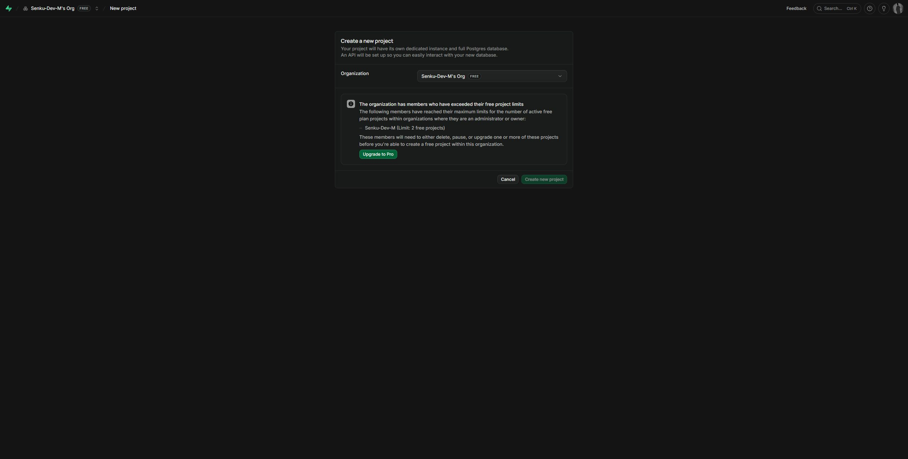

La captura muestra también un caso importante: si Supabase indica que alcanzaste
el límite de proyectos gratuitos, detente. No borres un proyecto existente ni
contrates un plan para continuar sin decidirlo conscientemente.

### Contraseña correcta

La contraseña solicitada al crear el proyecto es la contraseña de PostgreSQL.
No es:

- la contraseña de tu cuenta Supabase;
- una API key;
- la `anon key`;
- la `service_role key`.

Si la olvidaste, puedes restablecerla desde la configuración de la base de
datos, pero al hacerlo romperás conexiones que sigan usando la contraseña
anterior.

---

## 5. Obtener los datos de conexión

1. Abre tu proyecto en Supabase.
2. Pulsa **Connect** en la zona superior del Dashboard.
3. En la pestaña de conexión directa, localiza **Connection Method**.
4. Selecciona **Session pooler**.
5. Expande **Connection parameters** si está contraído.
6. Copia y guarda temporalmente estos valores:
   - `host`;
   - `port`;
   - `database`;
   - `user`.
7. No copies la cadena en un archivo del repositorio.

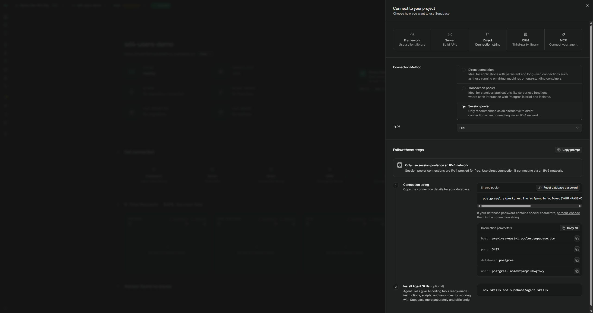

Debes obtener valores con esta forma:

```text
Host:     aws-<INDICE>-<REGION>.pooler.supabase.com
Port:     5432
Database: postgres
User:     postgres.<PROJECT_REF>
```

No escribas `<INDICE>`, `<REGION>` ni `<PROJECT_REF>` literalmente. Utiliza los
valores exactos de tu Dashboard.

### Qué conexión usar en cada momento

| Acción | Primera opción | Alternativa |
|---|---|---|
| Ejecutar migraciones | Direct connection | Session pooler si tu red solo tiene IPv4 |
| Ejecutar la API local | Session pooler | Direct connection si tu red llega por IPv6 |
| Función serverless | Transaction pooler | Según arquitectura |

Para este tutorial, la API funcionará mediante **Session pooler**. Para
`dotnet ef database update`, intenta primero la conexión directa; si falla por
IPv6 en el plan Free, utiliza Session pooler. Nunca uses Transaction pooler para
la migración.

---

## 6. Descargar y utilizar el certificado SSL

Descargar el certificado no basta: Npgsql debe recibir su ruta mediante la
cadena de conexión.

### 6.1 Descargarlo

1. En el menú izquierdo abre **Database**.
2. En la sección de configuración abre **Settings**.
3. Desplázate hasta **SSL configuration**.
4. En **SSL Certificate**, pulsa **Download certificate**.

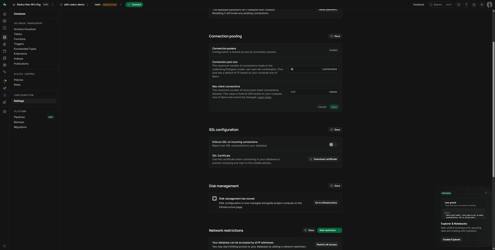

### 6.2 Guardarlo en una ruta estable

No lo dejes en Descargas si después vas a moverlo. Crea una carpeta permanente,
por ejemplo:

```powershell
New-Item -ItemType Directory -Force "$env:USERPROFILE\.certs" | Out-Null
```

Mueve el archivo descargado a esa carpeta y renómbralo si deseas:

```text
C:\Users\TU_USUARIO\.certs\supabase-prod-ca.crt
```

Comprueba que existe:

```powershell
Test-Path "$env:USERPROFILE\.certs\supabase-prod-ca.crt"
```

El resultado debe ser:

```text
True
```

### 6.3 Configurarlo en Npgsql

La cadena de conexión Npgsql tendrá esta forma:

```text
Host=<HOST_DEL_POOLER>;Port=5432;Database=postgres;
Username=postgres.<PROJECT_REF>;Password=<CONTRASEÑA_POSTGRES>;
SSL Mode=VerifyFull;Root Certificate=C:\Users\TU_USUARIO\.certs\supabase-prod-ca.crt
```

Escríbela en una sola línea al configurarla.

`SSL Mode=VerifyFull` hace tres cosas:

1. exige cifrado TLS;
2. comprueba que el certificado fue firmado por la autoridad indicada;
3. comprueba que el nombre del host coincide con el certificado.

No utilices `Trust Server Certificate=true` para silenciar un error. Corrige la
ruta, el host o el certificado.

> En Npgsql 10, cuando se proporciona `Root Certificate`, ese certificado raíz
> se utiliza para validar la cadena TLS. No confundas el certificado público de
> la autoridad con un certificado de cliente o una clave privada.

### Contraseñas con caracteres especiales

La cadena Npgsql utiliza pares `Clave=Valor` separados por punto y coma. Si la
contraseña contiene `;`, coloca el valor entre comillas dobles:

```text
Password="mi;contraseña";
```

No uses el formato URI de PostgreSQL como si fuera la cadena Npgsql sin revisar
el escape de caracteres. Esta guía utiliza el formato por parámetros para evitar
esa confusión.

---

## 7. Crear la estructura local

Abre PowerShell en la carpeta donde quieras crear la práctica:

```powershell
mkdir tutorial-supabase-dotnet
cd tutorial-supabase-dotnet

dotnet new web -n ProductsEf -o 01-ef/ProductsEf -f net10.0
dotnet new web -n ProductsSql -o 02-sql/ProductsSql -f net10.0

dotnet new tool-manifest
dotnet tool install dotnet-ef --version 10.0.14
```

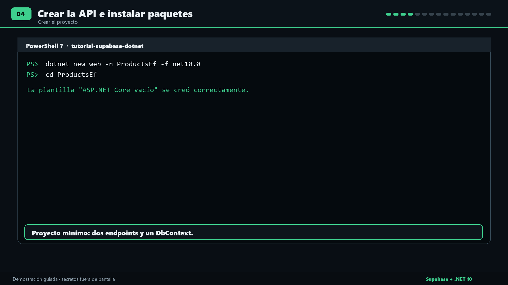

Instala los paquetes en el proyecto EF:

```powershell
dotnet add 01-ef/ProductsEf package Microsoft.EntityFrameworkCore --version 10.0.14
dotnet add 01-ef/ProductsEf package Microsoft.EntityFrameworkCore.Relational --version 10.0.14
dotnet add 01-ef/ProductsEf package Microsoft.EntityFrameworkCore.Design --version 10.0.14
dotnet add 01-ef/ProductsEf package Npgsql.EntityFrameworkCore.PostgreSQL --version 10.0.3
dotnet add 01-ef/ProductsEf package Npgsql --version 10.0.3
```

Instala los mismos paquetes de ejecución en el proyecto SQL:

```powershell
dotnet add 02-sql/ProductsSql package Microsoft.EntityFrameworkCore --version 10.0.14
dotnet add 02-sql/ProductsSql package Microsoft.EntityFrameworkCore.Relational --version 10.0.14
dotnet add 02-sql/ProductsSql package Microsoft.EntityFrameworkCore.Design --version 10.0.14
dotnet add 02-sql/ProductsSql package Npgsql.EntityFrameworkCore.PostgreSQL --version 10.0.3
dotnet add 02-sql/ProductsSql package Npgsql --version 10.0.3
```

Genera y conserva archivos de bloqueo:

```powershell
dotnet restore 01-ef/ProductsEf --use-lock-file
dotnet restore 02-sql/ProductsSql --use-lock-file
```

En restauraciones futuras puedes exigir exactamente las versiones bloqueadas:

```powershell
dotnet restore 01-ef/ProductsEf --locked-mode
dotnet restore 02-sql/ProductsSql --locked-mode
```

La estructura final será:

```text
tutorial-supabase-dotnet/
├─ .config/
│  └─ dotnet-tools.json
├─ 01-ef/
│  └─ ProductsEf/
├─ 02-sql/
│  └─ ProductsSql/
└─ sql/
   └─ products.sql
```

---

## 8. Guardar la conexión de forma segura

No coloques la contraseña en `Program.cs`, `appsettings.json`, un Markdown, un
commit o una captura de pantalla.

Inicializa User Secrets en el primer proyecto:

```powershell
dotnet user-secrets init --project 01-ef/ProductsEf
```

Inicialízalo también en el segundo:

```powershell
dotnet user-secrets init --project 02-sql/ProductsSql
```

Configura la conexión del primer proyecto:

```powershell
dotnet user-secrets set "ConnectionStrings:Supabase" `
  "Host=<HOST>;Port=5432;Database=postgres;Username=postgres.<PROJECT_REF>;Password=<CONTRASEÑA>;SSL Mode=VerifyFull;Root Certificate=C:\Users\TU_USUARIO\.certs\supabase-prod-ca.crt" `
  --project 01-ef/ProductsEf
```

Repite con el segundo proyecto:

```powershell
dotnet user-secrets set "ConnectionStrings:Supabase" `
  "Host=<HOST>;Port=5432;Database=postgres;Username=postgres.<PROJECT_REF>;Password=<CONTRASEÑA>;SSL Mode=VerifyFull;Root Certificate=C:\Users\TU_USUARIO\.certs\supabase-prod-ca.crt" `
  --project 02-sql/ProductsSql
```

Los marcadores deben reemplazarse por valores reales. No ejecutes literalmente
un comando que todavía contenga `<HOST>` o `<CONTRASEÑA>`.

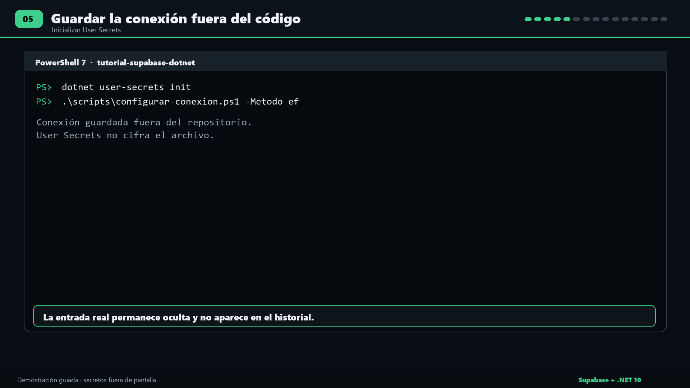

### Alternativa sin mostrar la contraseña en el historial

El material incluye `scripts/configurar-conexion.ps1`. Solicita la cadena con
entrada oculta:

```powershell
.\scripts\configurar-conexion.ps1 -Metodo ef
.\scripts\configurar-conexion.ps1 -Metodo sql
```

### Qué protege User Secrets

User Secrets:

- guarda el valor fuera del repositorio;
- evita que Git lo incluya por accidente;
- lo carga automáticamente en ASP.NET Core durante desarrollo.

User Secrets **no cifra el archivo**. No es un gestor de secretos para
producción.

Para producción utiliza el mecanismo seguro de la plataforma. La variable de
entorno equivalente es:

```text
ConnectionStrings__Supabase
```

El doble guion bajo representa los dos puntos de `ConnectionStrings:Supabase`.

---

# MÉTODO 1 — EF Core crea `products_ef`

## 9. Crear el modelo `Product`

Crea `01-ef/ProductsEf/Product.cs`:

```csharp
namespace ProductsEf;

public class Product
{
    public int Id { get; set; }
    public string Name { get; set; } = "";
    public decimal Price { get; set; }
}

public record CreateProductRequest(string? Name, decimal Price);
```

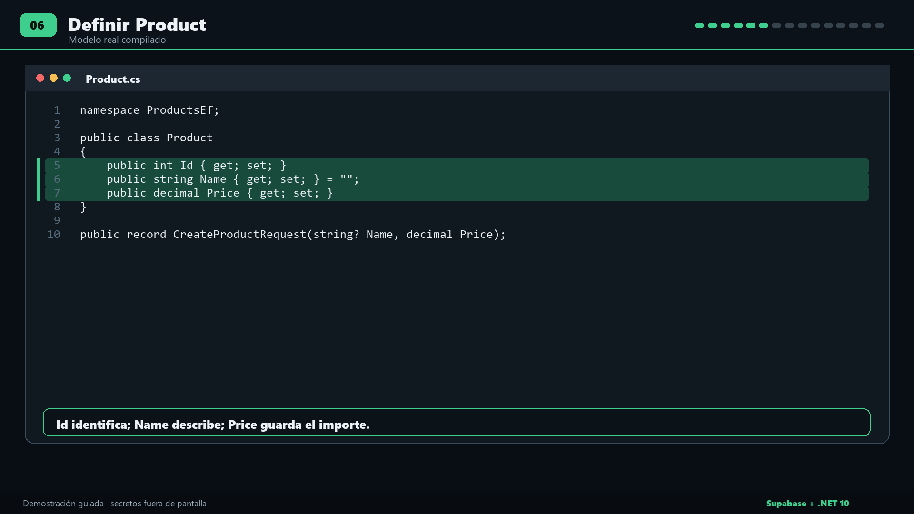

Significado:

- `Id`: será la clave primaria e identidad PostgreSQL.
- `Name`: será obligatorio y tendrá máximo 120 caracteres.
- `Price`: será `numeric(10,2)`.
- `CreateProductRequest`: representa el JSON recibido por el POST.

---

## 10. Crear el `DbContext`

Crea `01-ef/ProductsEf/ProductsDbContext.cs`:

```csharp
using Microsoft.EntityFrameworkCore;

namespace ProductsEf;

public class ProductsDbContext(DbContextOptions<ProductsDbContext> options)
    : DbContext(options)
{
    public DbSet<Product> Products => Set<Product>();

    protected override void OnModelCreating(ModelBuilder modelBuilder)
    {
        var product = modelBuilder.Entity<Product>();

        product.ToTable("products_ef", "public");
        product.HasKey(p => p.Id);

        product.Property(p => p.Id)
            .HasColumnName("id")
            .UseIdentityByDefaultColumn();

        product.Property(p => p.Name)
            .HasColumnName("name")
            .HasMaxLength(120)
            .IsRequired();

        product.Property(p => p.Price)
            .HasColumnName("price")
            .HasPrecision(10, 2)
            .IsRequired();
    }
}
```

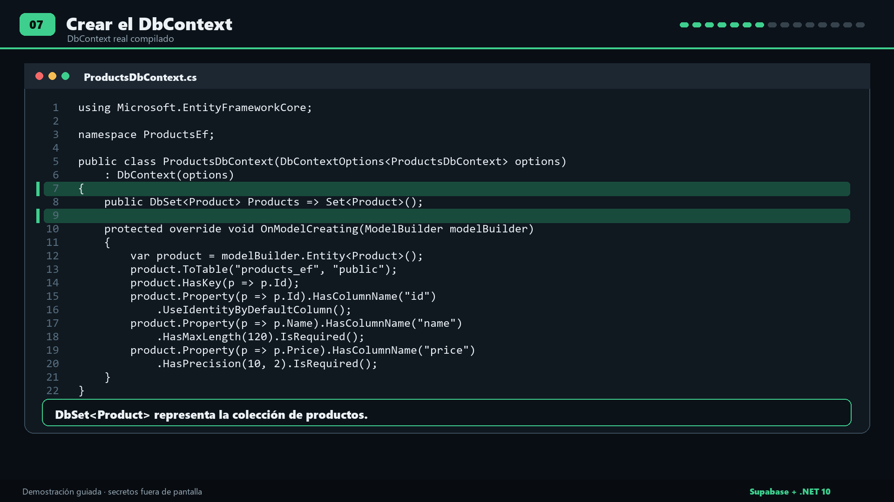

La línea decisiva es:

```csharp
product.ToTable("products_ef", "public");
```

Indica que `Product` se guarda en `public.products_ef`.

---

## 11. Configurar Npgsql y los endpoints

Reemplaza el contenido de `01-ef/ProductsEf/Program.cs`:

```csharp
using Microsoft.EntityFrameworkCore;
using ProductsEf;

var builder = WebApplication.CreateBuilder(args);

var connectionString = builder.Configuration
    .GetConnectionString("Supabase");

if (string.IsNullOrWhiteSpace(connectionString))
{
    Console.Error.WriteLine(
        "Falta ConnectionStrings:Supabase. Configura User Secrets o " +
        "ConnectionStrings__Supabase antes de iniciar.");
    Environment.ExitCode = 1;
    return;
}

builder.Services.AddDbContext<ProductsDbContext>(options =>
    options.UseNpgsql(connectionString));

var app = builder.Build();

app.MapGet("/products", async (ProductsDbContext db) =>
    Results.Ok(await db.Products
        .AsNoTracking()
        .OrderBy(p => p.Id)
        .ToListAsync()));

app.MapPost("/products", async (
    CreateProductRequest request,
    ProductsDbContext db) =>
{
    var name = request.Name?.Trim();

    if (string.IsNullOrWhiteSpace(name) || name.Length > 120)
        return Results.BadRequest(new
        {
            error = "El nombre requiere entre 1 y 120 caracteres."
        });

    if (request.Price < 0 ||
        request.Price > 99999999.99m ||
        decimal.Round(request.Price, 2) != request.Price)
        return Results.BadRequest(new
        {
            error = "El precio debe estar entre 0 y 99999999.99, " +
                    "con hasta 2 decimales."
        });

    var product = new Product
    {
        Name = name,
        Price = request.Price
    };

    db.Products.Add(product);
    await db.SaveChangesAsync();

    return Results.Created($"/products/{product.Id}", product);
});

// No usar EnsureCreated() ni aplicar migraciones automáticamente al arrancar.
app.Run();
```

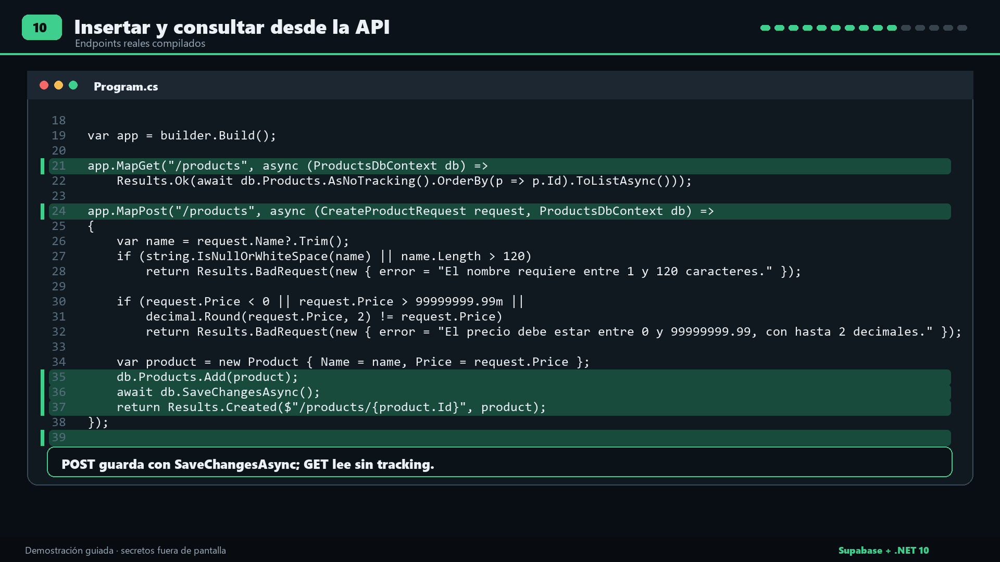

Puntos importantes:

- `GetConnectionString("Supabase")` lee `ConnectionStrings:Supabase`.
- `UseNpgsql` configura el proveedor PostgreSQL.
- `AsNoTracking()` evita seguimiento innecesario en una lectura.
- `SaveChangesAsync()` ejecuta el `INSERT`.
- `Results.Created()` devuelve HTTP `201` y el ID generado.
- La aplicación no crea ni actualiza el esquema al iniciar.

Comprueba que compila:

```powershell
dotnet build 01-ef/ProductsEf
```

---

## 12. Generar la migración

Desde la raíz de `tutorial-supabase-dotnet` ejecuta:

```powershell
dotnet ef migrations add InitialCreate `
  --project 01-ef/ProductsEf `
  --startup-project 01-ef/ProductsEf
```

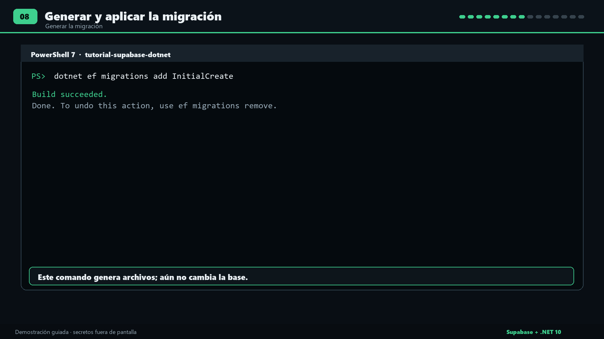

Esto crea la carpeta `01-ef/ProductsEf/Migrations`.

**Todavía no modifica Supabase.** Solo genera archivos C# que describen el
cambio.

Abre la migración recién creada y comprueba que contiene:

- `CreateTable` para `products_ef`;
- `integer` e identidad para `id`;
- `character varying(120)` para `name`;
- `numeric(10,2)` para `price`;
- clave primaria sobre `id`.

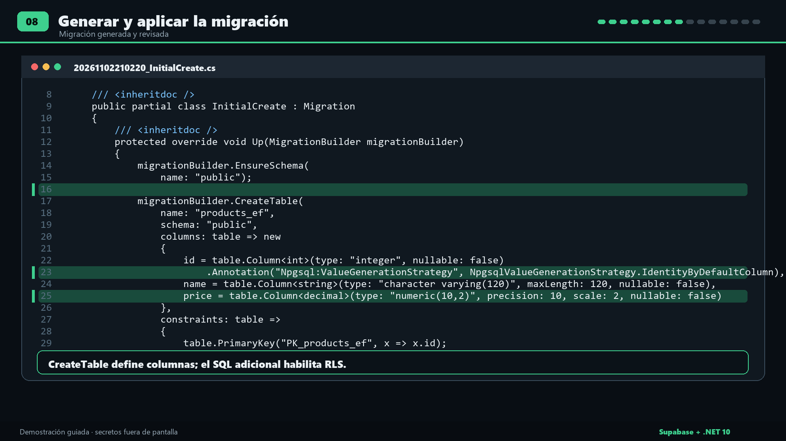

### Habilitar RLS desde la migración

Después de `CreateTable`, dentro de `Up`, añade:

```csharp
migrationBuilder.Sql("""
    ALTER TABLE public.products_ef ENABLE ROW LEVEL SECURITY;
    REVOKE ALL ON TABLE public.products_ef FROM anon, authenticated;
    ALTER TABLE public."__EFMigrationsHistory" ENABLE ROW LEVEL SECURITY;
    REVOKE ALL ON TABLE public."__EFMigrationsHistory" FROM anon, authenticated;
    """);
```

Esto evita exponer estas tablas a los roles de la Data API.

No agregamos políticas públicas porque esta API se conecta como usuario
PostgreSQL administrativo desde el backend. El usuario `postgres` puede omitir
RLS; por ello, RLS no sustituye la separación de roles y privilegios mínimos en
producción.

---

## 13. Aplicar la migración en Supabase

### Opción recomendada: conexión directa

Si tu red tiene IPv6:

1. Abre **Connect**.
2. Selecciona **Direct connection**.
3. Copia host, puerto, base y usuario.
4. Configura temporalmente esa cadena en User Secrets del proyecto EF.
5. Conserva `SSL Mode=VerifyFull` y la ruta del certificado.

Ejecuta:

```powershell
dotnet ef database update `
  --project 01-ef/ProductsEf `
  --startup-project 01-ef/ProductsEf
```

### Si la conexión directa falla por IPv6

Configura la cadena del **Session pooler** en User Secrets y ejecuta el mismo
comando. Session pooler mantiene una sesión y es la alternativa IPv4 indicada
por Supabase.

No uses el puerto `6543` ni Transaction pooler.

Cuando termine correctamente, EF Core habrá creado:

- `public.products_ef`;
- `public.__EFMigrationsHistory`.

La tabla de historial registra qué migraciones ya fueron aplicadas.

Ejecuta nuevamente `database update`:

```powershell
dotnet ef database update `
  --project 01-ef/ProductsEf `
  --startup-project 01-ef/ProductsEf
```

No debe duplicar tablas ni datos. EF Core consultará el historial y no aplicará
otra vez `InitialCreate`.

Después de migrar, vuelve a configurar **Session pooler** para ejecutar la API.

---

## 14. Verificar `products_ef` en Supabase

1. Regresa al Dashboard.
2. Abre **Table Editor**. Si tu versión lo muestra dentro de Database, abre
   **Database → Tables**.
3. Selecciona el esquema `public`.
4. Abre `products_ef`.
5. Comprueba:
   - `id`: integer, primary key, identity;
   - `name`: varchar, máximo 120, no nulo;
   - `price`: numeric, precisión 10 y escala 2, no nulo.
6. Abre también `__EFMigrationsHistory` y comprueba que contiene
   `InitialCreate`.

También puedes comprobarlo desde **SQL Editor**:

```sql
select table_name, column_name, data_type,
       character_maximum_length,
       numeric_precision, numeric_scale,
       is_nullable, is_identity, identity_generation
from information_schema.columns
where table_schema = 'public'
  and table_name = 'products_ef'
order by ordinal_position;
```

Comprueba RLS:

```sql
select relname, relrowsecurity
from pg_class
where oid = 'public.products_ef'::regclass;
```

`relrowsecurity` debe ser `true`.

---

## 15. Ejecutar y probar la primera API

Inicia la API:

```powershell
dotnet run --project 01-ef/ProductsEf --urls http://localhost:5080
```

No cierres esa terminal. Abre otra PowerShell y ejecuta:

```powershell
$body = @{
    name = "Cuaderno"
    price = 12.50
} | ConvertTo-Json

$created = Invoke-RestMethod `
    -Uri http://localhost:5080/products `
    -Method Post `
    -ContentType "application/json" `
    -Body $body

$created
```

Debes recibir algo similar a:

```text
id name      price
-- ----      -----
 1 Cuaderno  12.50
```

Consulta todos los productos:

```powershell
Invoke-RestMethod -Uri http://localhost:5080/products
```

### Confirmación visual

1. Regresa a `products_ef` en Table Editor.
2. Pulsa refrescar.
3. Comprueba el mismo `id`, `name` y `price` devuelto por la API.
4. Detén la API con `Ctrl+C`.
5. Iníciala nuevamente.
6. Repite el GET.

Si la fila sigue presente, confirmaste persistencia en PostgreSQL y no memoria
temporal de la aplicación.

### Probar validaciones

Nombre vacío:

```powershell
Invoke-RestMethod `
  -Uri http://localhost:5080/products `
  -Method Post `
  -ContentType "application/json" `
  -Body '{"name":"","price":12.50}'
```

Precio negativo:

```powershell
Invoke-RestMethod `
  -Uri http://localhost:5080/products `
  -Method Post `
  -ContentType "application/json" `
  -Body '{"name":"Cuaderno","price":-1}'
```

Ambos deben devolver HTTP `400 Bad Request`.

---

# MÉTODO 2 — SQL Editor crea `products_sql`

## 16. Crear la tabla manualmente

1. En Supabase abre **SQL Editor**.
2. Pulsa **New query** o el botón `+` para crear una consulta.
3. Pega exactamente este script:

```sql
create table public.products_sql (
    id integer generated by default as identity primary key,
    name varchar(120) not null,
    price numeric(10,2) not null
);

alter table public.products_sql enable row level security;
revoke all on table public.products_sql from anon, authenticated;
```

4. Revisa que el nombre sea `products_sql`, no `products_ef`.
5. Pulsa **Run**.
6. Debes ver un resultado similar a **Success. No rows returned**.

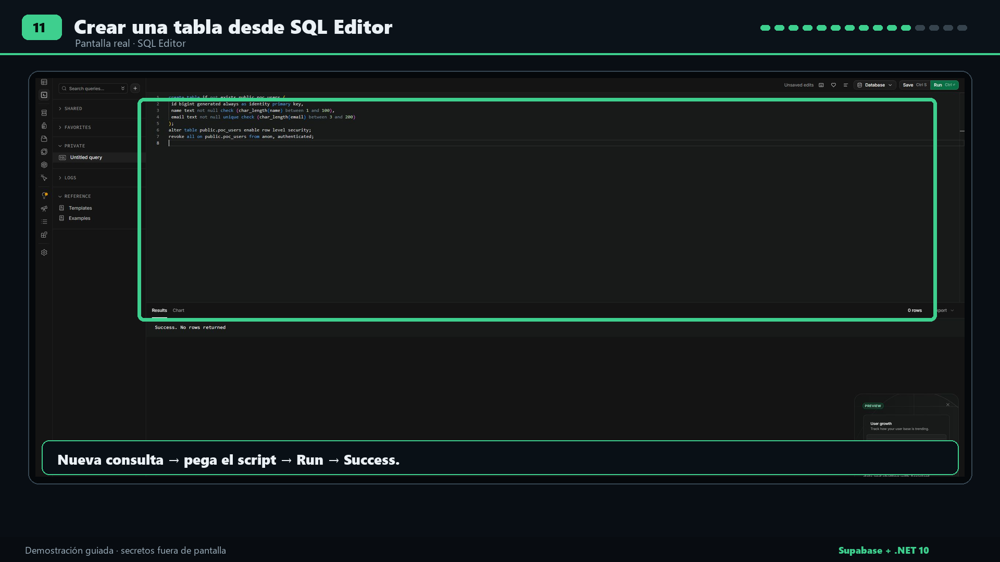

La captura es una referencia real del editor. El script de esta guía crea
`products_sql`; no copies el nombre de la tabla de una captura antigua.

### Qué hace cada instrucción

```sql
create table public.products_sql (...);
```

Crea la tabla dentro del esquema `public`.

```sql
generated by default as identity
```

Permite que PostgreSQL genere el ID automáticamente.

```sql
alter table ... enable row level security;
```

Habilita RLS.

```sql
revoke all ... from anon, authenticated;
```

Evita que los roles de la Data API tengan permisos sobre esta tabla.

Desde el 30 de octubre de 2026, Supabase ya no expone automáticamente nuevas
tablas a Data API/GraphQL. Eso es independiente de RLS. Esta guía no necesita
Data API porque Npgsql conecta directamente con PostgreSQL.

### Verificación visual

1. Abre **Table Editor** o **Database → Tables**.
2. Selecciona `public.products_sql`.
3. Comprueba las tres columnas.
4. La tabla debe estar vacía antes de ejecutar la segunda API.

---

## 17. Configurar la segunda aplicación

El modelo es igual, pero cambia el namespace. Crea
`02-sql/ProductsSql/Product.cs`:

```csharp
namespace ProductsSql;

public class Product
{
    public int Id { get; set; }
    public string Name { get; set; } = "";
    public decimal Price { get; set; }
}

public record CreateProductRequest(string? Name, decimal Price);
```

Crea `02-sql/ProductsSql/ProductsDbContext.cs`:

```csharp
using Microsoft.EntityFrameworkCore;

namespace ProductsSql;

public class ProductsDbContext(DbContextOptions<ProductsDbContext> options)
    : DbContext(options)
{
    public DbSet<Product> Products => Set<Product>();

    protected override void OnModelCreating(ModelBuilder modelBuilder)
    {
        var product = modelBuilder.Entity<Product>();

        product.ToTable("products_sql", "public");
        product.HasKey(p => p.Id);

        product.Property(p => p.Id)
            .HasColumnName("id")
            .UseIdentityByDefaultColumn();

        product.Property(p => p.Name)
            .HasColumnName("name")
            .HasMaxLength(120)
            .IsRequired();

        product.Property(p => p.Price)
            .HasColumnName("price")
            .HasPrecision(10, 2)
            .IsRequired();
    }
}
```

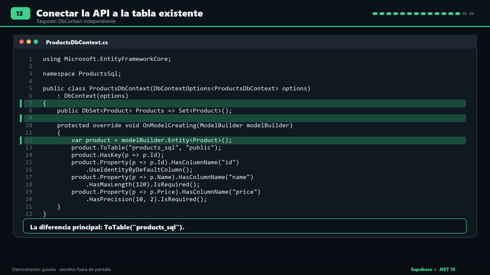

La diferencia esencial es:

```csharp
product.ToTable("products_sql", "public");
```

Reemplaza por completo `02-sql/ProductsSql/Program.cs`:

```csharp
using Microsoft.EntityFrameworkCore;
using ProductsSql;

var builder = WebApplication.CreateBuilder(args);

var connectionString = builder.Configuration
    .GetConnectionString("Supabase");

if (string.IsNullOrWhiteSpace(connectionString))
{
    Console.Error.WriteLine(
        "Falta ConnectionStrings:Supabase. Configura User Secrets o " +
        "ConnectionStrings__Supabase antes de iniciar.");
    Environment.ExitCode = 1;
    return;
}

builder.Services.AddDbContext<ProductsDbContext>(options =>
    options.UseNpgsql(connectionString));

var app = builder.Build();

app.MapGet("/products", async (ProductsDbContext db) =>
    Results.Ok(await db.Products
        .AsNoTracking()
        .OrderBy(p => p.Id)
        .ToListAsync()));

app.MapPost("/products", async (
    CreateProductRequest request,
    ProductsDbContext db) =>
{
    var name = request.Name?.Trim();

    if (string.IsNullOrWhiteSpace(name) || name.Length > 120)
        return Results.BadRequest(new
        {
            error = "El nombre requiere entre 1 y 120 caracteres."
        });

    if (request.Price < 0 ||
        request.Price > 99999999.99m ||
        decimal.Round(request.Price, 2) != request.Price)
        return Results.BadRequest(new
        {
            error = "El precio debe estar entre 0 y 99999999.99, " +
                    "con hasta 2 decimales."
        });

    var product = new Product
    {
        Name = name,
        Price = request.Price
    };

    db.Products.Add(product);
    await db.SaveChangesAsync();

    return Results.Created($"/products/{product.Id}", product);
});

// La tabla ya fue creada por SQL Editor.
// No usar EnsureCreated() ni Database.Migrate().
app.Run();
```

### Regla crítica del método SQL

En `ProductsSql`:

- no crees una carpeta `Migrations`;
- no ejecutes `dotnet ef migrations add`;
- no ejecutes `dotnet ef database update`;
- no llames `EnsureCreated()`;
- no llames `Database.Migrate()` al iniciar.

La tabla ya existe porque la creó SQL Editor. EF Core solamente la mapea y la
utiliza.

Compila:

```powershell
dotnet build 02-sql/ProductsSql
```

---

## 18. Ejecutar y probar la segunda API

Asegúrate de haber detenido la primera API con `Ctrl+C` para liberar el puerto
5080.

Inicia la segunda:

```powershell
dotnet run --project 02-sql/ProductsSql --urls http://localhost:5080
```

En otra terminal:

```powershell
$body = @{
    name = "Lápiz"
    price = 3.25
} | ConvertTo-Json

$created = Invoke-RestMethod `
    -Uri http://localhost:5080/products `
    -Method Post `
    -ContentType "application/json" `
    -Body $body

$created

Invoke-RestMethod -Uri http://localhost:5080/products
```

Regresa al Table Editor, abre `products_sql` y refresca. Debes ver `Lápiz` con el
mismo ID y precio devueltos por la API.

Detén y reinicia la API. El GET debe devolver la misma fila.

---

## 19. Comparar las estructuras

Ejecuta en SQL Editor:

```sql
select table_name,
       column_name,
       data_type,
       character_maximum_length,
       numeric_precision,
       numeric_scale,
       is_nullable,
       is_identity,
       identity_generation
from information_schema.columns
where table_schema = 'public'
  and table_name in ('products_ef', 'products_sql')
order by table_name, ordinal_position;
```

Comprueba RLS:

```sql
select relname, relrowsecurity
from pg_class
where oid in (
    'public.products_ef'::regclass,
    'public.products_sql'::regclass
);
```

Consulta los datos:

```sql
select * from public.products_ef order by id;
select * from public.products_sql order by id;
```

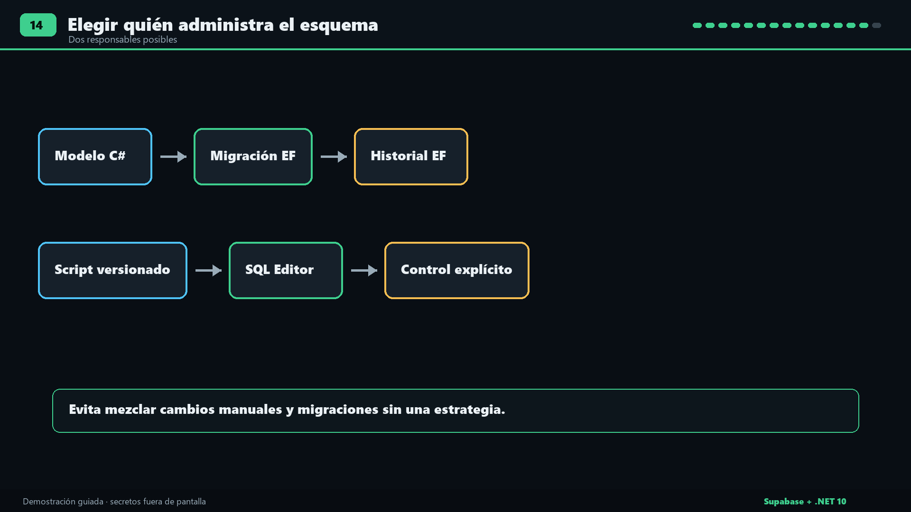

---

## 20. Cuándo usar cada método

### Migraciones de EF Core

Úsalas cuando:

- el modelo de dominio se administra principalmente desde C#;
- quieres un historial incremental versionado;
- necesitas que el equipo pueda reproducir los cambios de esquema;
- quieres que EF Core determine diferencias entre el modelo actual y el
  snapshot anterior.

Ventaja principal: el esquema evoluciona junto al código.

Riesgo principal: aplicar migraciones sin revisar puede producir cambios no
deseados. Revisa siempre el archivo generado.

### SQL explícito

Úsalo cuando:

- necesitas control exacto sobre el SQL;
- trabajas con características específicas de PostgreSQL;
- la base ya existe y la aplicación solo debe mapearla;
- el equipo administra el esquema mediante scripts revisados.

Ventaja principal: control completo y visible.

Riesgo principal: un cambio manual en SQL Editor no actualiza el snapshot ni el
historial de EF Core.

Aunque uses SQL Editor, guarda el script `.sql` en control de versiones. SQL
manual no significa SQL sin historial.

### No mezclar sin una estrategia

No dejes que EF Core administre una tabla mientras otras personas la cambian
manualmente sin registrar esos cambios. Elige una fuente de verdad para cada
objeto.

---

## 21. Diagnóstico de errores comunes

### `Falta ConnectionStrings:Supabase`

La aplicación no encontró la conexión.

Comprueba:

```powershell
dotnet user-secrets list --project 01-ef/ProductsEf
```

o:

```powershell
dotnet user-secrets list --project 02-sql/ProductsSql
```

Debe existir la clave `ConnectionStrings:Supabase`. No compartas la salida,
porque contiene la contraseña.

### `Tenant or user not found`

Suele indicar que estás usando el host del pooler con un usuario incorrecto.

Para Session pooler el usuario debe ser:

```text
postgres.<PROJECT_REF>
```

Vuelve a copiar host y usuario desde **Connect → Session pooler**.

### `password authentication failed`

La contraseña PostgreSQL no coincide.

- No uses la contraseña de tu cuenta Supabase.
- Revisa caracteres especiales.
- Si restableciste la contraseña, actualiza User Secrets.

### No se puede resolver `db.<ref>.supabase.co`

La conexión directa normalmente usa IPv6 en el plan Free. Si tu red es solo
IPv4, utiliza Session pooler.

### Error de certificado o nombre de host

Revisa:

1. que `Test-Path` devuelva `True`;
2. que la ruta apunte al certificado descargado del proyecto;
3. que el host sea exactamente el copiado del Dashboard;
4. que estés usando `SSL Mode=VerifyFull`;
5. que no hayas renombrado el contenido del certificado ni descargado HTML por
   error.

### `relation "public.products_ef" does not exist`

No aplicaste la migración, la aplicaste en otro proyecto o tu conexión apunta a
otra base.

Ejecuta:

```powershell
dotnet ef migrations list `
  --project 01-ef/ProductsEf `
  --startup-project 01-ef/ProductsEf
```

Después aplica `database update` con la conexión correcta.

### `relation "public.products_sql" does not exist`

El script SQL no fue ejecutado correctamente o la segunda aplicación apunta a
otro proyecto Supabase.

Comprueba en Table Editor y vuelve a ejecutar el script una sola vez si la tabla
no existe.

### `relation "products_sql" already exists`

La tabla ya existe. No repitas `CREATE TABLE` a ciegas. Verifica su estructura.
No la borres si puede contener datos.

### `permission denied for table ...`

Comprueba el usuario PostgreSQL de la cadena. Este tutorial se conecta como
`postgres` o `postgres.<PROJECT_REF>` mediante pooler. Un rol limitado necesita
`GRANT` explícitos.

No desactives RLS ni agregues políticas públicas solo para eliminar el error.

### `dotnet ef` no existe

Desde la raíz, restaura la herramienta local:

```powershell
dotnet tool restore
dotnet ef --version
```

### El puerto 5080 ya está ocupado

Detén la primera API con `Ctrl+C` antes de iniciar la segunda. Como alternativa,
usa otro puerto:

```powershell
dotnet run --project 02-sql/ProductsSql --urls http://localhost:5081
```

En ese caso, cambia también la URL de las peticiones.

---

## 22. Checklist final

### Supabase

- [ ] El proyecto fue creado sin coste inesperado.
- [ ] Guardaste la contraseña PostgreSQL de forma segura.
- [ ] Copiaste host, puerto, base y usuario desde el Dashboard.
- [ ] Session pooler usa puerto `5432`.
- [ ] No estás usando Transaction pooler para migraciones.
- [ ] Descargaste el certificado desde Database Settings.
- [ ] La ruta del certificado existe.
- [ ] `products_ef` existe.
- [ ] `products_sql` existe.
- [ ] Ambas tablas tienen RLS habilitado.

### .NET

- [ ] `dotnet build 01-ef/ProductsEf` termina correctamente.
- [ ] `dotnet build 02-sql/ProductsSql` termina correctamente.
- [ ] La conexión está en User Secrets o variable de entorno.
- [ ] No hay contraseñas en archivos versionados.
- [ ] El método EF tiene migraciones.
- [ ] El método SQL no tiene migraciones.
- [ ] Ninguna API llama `EnsureCreated()`.
- [ ] Ninguna API llama `Database.Migrate()` al arrancar.

### Pruebas

- [ ] POST devuelve HTTP `201`.
- [ ] GET devuelve el mismo ID.
- [ ] Table Editor muestra la misma fila.
- [ ] La fila persiste después de reiniciar la API.
- [ ] Nombre vacío devuelve HTTP `400`.
- [ ] Precio inválido devuelve HTTP `400`.
- [ ] Ejecutar nuevamente `database update` no duplica nada.
- [ ] Las dos tablas coinciden en tipo, nulabilidad, identidad y clave primaria.

---

## 23. Archivos completos incluidos en este workspace

- Método EF: [`01-ef/ProductsEf`](01-ef/ProductsEf/).
- Método SQL: [`02-sql/ProductsSql`](02-sql/ProductsSql/).
- SQL de creación: [`sql/products.sql`](sql/products.sql).
- SQL de verificación: [`sql/verificar.sql`](sql/verificar.sql).
- Configuración segura: [`scripts/configurar-conexion.ps1`](scripts/configurar-conexion.ps1).
- Prueba automatizada: [`scripts/probar-api.ps1`](scripts/probar-api.ps1).

---

## 24. Fuentes oficiales

- [Supabase: Connect to your database](https://supabase.com/docs/guides/database/connecting-to-postgres)
- [Supabase: Connection pooling and limits](https://supabase.com/docs/guides/database/connecting-to-postgres/pooling-and-limits)
- [Supabase: PostgreSQL SSL enforcement](https://supabase.com/docs/guides/platform/ssl-enforcement)
- [Supabase: Production security checklist](https://supabase.com/docs/guides/security/production-checklist)
- [Npgsql: Security and encryption](https://www.npgsql.org/doc/security.html)
- [Npgsql: Connection string parameters](https://www.npgsql.org/doc/connection-string-parameters)
- [Microsoft: EF Core migrations](https://learn.microsoft.com/en-us/ef/core/managing-schemas/migrations/)
- [Microsoft: User Secrets in ASP.NET Core](https://learn.microsoft.com/en-us/aspnet/core/security/app-secrets?view=aspnetcore-10.0)

